# Unity核心\_2D

## 2D相关

### 图片导入概述

- 常用的图片格式JPG，PNG，TGA
- 纹理类型
  - 指明用途
  - Texture Type：纹理类型
    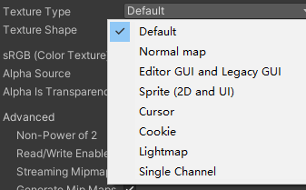

    - Default<br>默认纹理，大部分导入的模型贴图都是该类型
      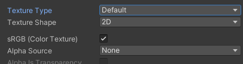

        - sRGB(Color Texture)：启用可以将纹理存储在伽马空间中（对每一个像素做一次幂函数运算）
          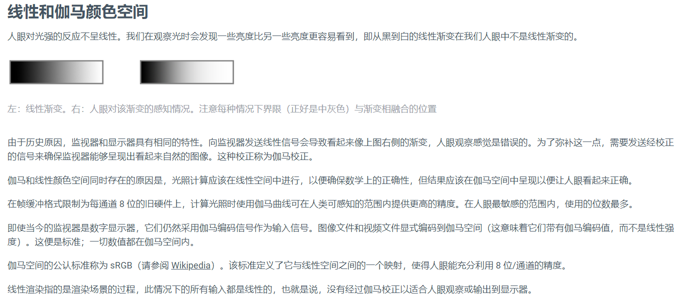

        - Alpha Source：指定如何生成纹理的Alpha通道
          - None：无论输入纹理是否有Alpha通道，导入的纹理都没有Alpha通道
          - Input Texture Alpha：输入纹理中的Alpha
          - From Gray Scale：从输入纹理RGB值的平均值生成Alpha
        - Alpha Is Transparency：启用可以避免边缘上的过滤瑕疵
    - Normal map<br>法线贴图格式
      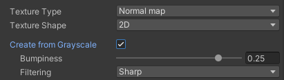

        - 法线贴图就是在原物体的凹凸表面的每个点上均作法线<br>法线就是垂直于某个点的切线的方向向量
          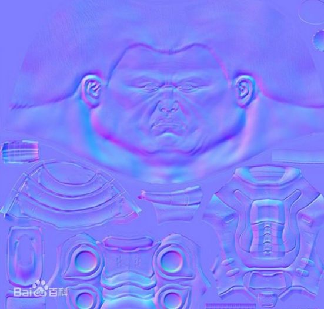

        - Create From Grayscale：<br>启用此属性可以从灰度高度贴图创建法线贴图
        - Bumpiness：<br>控制凹凸程度，值越大凹凸感越强
        - Filtering：<br>如何计算凹凸值
          - Smooth：使用标准算法生成法线贴图<br>Sharp：生成比标准模式更锐利的法线贴图
            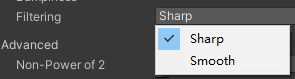

    - Editor GUI and Legacy GUI<br>一般在编辑器中或者GUI上使用的纹理
    - Sprite（2D and UI）<br>2D游戏或者UGUI中使用的格式
      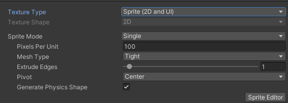

        - Sprite Mode：<br>图像中提取精灵图形的方式
          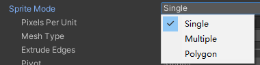

          - Single：按原样使用精灵图像
          - Multiple：瓦片模式，如果是图集，使用该选项，可以在Sprite Editor编辑窗口自定义图片
          - Polygon：网格精灵模式
        - Pixels Per Unit：世界空间中的一个距离单位对应多少像素
        - MeshType：网格类型；只有Single和Multiple模式才支持
          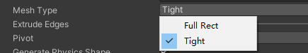

          - Full Rect：创建四边形，将精灵显示在四边形上
          - Tight：基于像素Alpha值来生成网格，更加贴合精灵图片的形状<br>任何小于32\*32的精灵都使用FullRect模式，即使设置成Tight模式也是
        - Extrude Edges：使用滑动条确定生成的网格中精灵周围流出的区域大小
        - Pivot：精灵图片的轴心点，Single模式才有此选项<br>对应九宫格布局的九个点，还可以自定义
          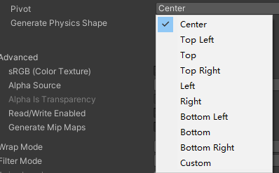

        - Generate Physics Shape：启用此选项，Unity会自动根据精灵轮廓生成默认物理形状<br>只有Single 和Multiple模式才可使用
        - Sprite Editor：编辑Sprite，需要安装2D Sprite包，之后单独讲解
    - Cursor<br>自定义光标
    - Cookie<br>光源剪影格式
      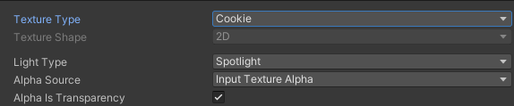

        - Light Type：应用的光源类型<br>一般点光源的剪影需要设置为立方体纹理<br>方向光和聚光灯的剪影设置为2D纹理
          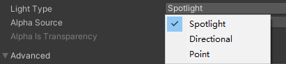

          - Spotlight：聚光灯类型，需要边缘纯黑色纹理
          - Directional：方向光，平铺纹理
          - Point：点光源，需要设置为立方体形状
    - Lightmap<br>光照贴图格式
    - Single Channel<br>纹理只需要单通道的格式
      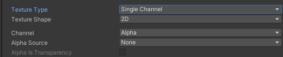

        - Channel：希望将纹理处理为Alpha还是Red通道<br>Alpha：使用Alpha通道，不允许进行压缩<br>Red：使用红色通道
          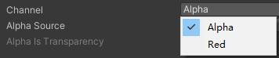

- 纹理形状
  - Texture Shape：纹理形状
    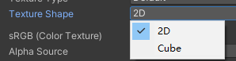

    - 2D：2D纹理，最常用设置，这些纹理将使用到模型和GUI元素上
    - Cube：立方体贴图，主要用于天空盒和反射探针
      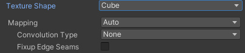

      - Mapping：如何将纹理投影到游戏对象上<br>Auto：根据纹理信息创建布局<br>6 Frames Layout：纹理包含标准立方体贴图布局之一排列的六个图像<br>Latitude-Longitude Layout：将纹理映射到2D维度/经度<br>Mirrored Ball：将纹理映射到类似球体的立方体贴图上
        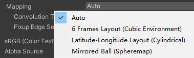

      - Convolution Type：纹理的过滤类型<br>None：无过滤<br>Specular：将立方体作为反射探针<br>Diffuse：将纹理进行过滤表示辐照度，可作为光照探针
        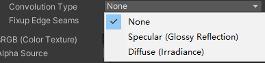

      - Fixup Edge Seams：Convolution Type 为None 和 Diffuse下才有用。解决低端设备上面之间立方体贴图过滤错误
- 高级设置
  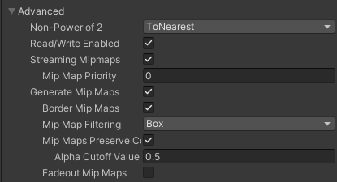

    - Non-Power of 2：如果纹理尺寸非2的幂如何处理
      - 为什么纹理要设置为2的N次方？<br>因为图形学规则，纹理必须是2的幂尺寸
      - None：纹理尺寸大小保持不变
      - To nearest：将纹理缩放到最接近2的幂的大小<br>（注意：PVRTC格式要求纹理为正方形）
      - To larger：将纹理缩放到最大尺寸大小值的2的幂的大小
      - To smaller：将纹理缩放到最小尺寸大小值的2的幂的大小
    - Read/Write Enabled：启用可以使用Unity中提供的一些方法从纹理中获取到数据（一般需要获取图片数据时才开启）
    - Streaming Mipmaps：启用则可以使用纹理串流，主要用于在控制加载在内存中的Mipmap级别，用于减少Unity对于纹理所需的内存总量，用性能换内存
      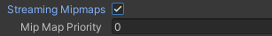

      - Mip Map Priority：<br>Mipmap优先级，Unity根据优先级来确定分配资源时优先考虑哪些Mipmap
    - Generate Mip Maps：允许生成MipMap
      - Border Mip Maps：启用可避免颜色向外渗透到较低MIP级别的边缘
      - Mip Map Filtering：<br>优化图像质量的过滤方法
        - Box：随着尺寸减小，级别更加平滑
        - Kaiser：随着Mipmap尺寸大小下降而使用的锐化算法，如果远处纹理太模糊，可以使用该算法
      - Mip Maps Preserve Coverage：<br>Mipmap的Alpha通道在Alpha测试期间保留覆盖率
        - Alpha Cutoff Value：覆盖率参考值
      - Fadeout Mip Maps：<br>级别递减时使Mipmap淡化为灰色
- 平铺拉伸
  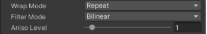

    - Wrap Mode：平铺纹理时的方式
      - Repeat：<br>在区块中重复纹理
      - Clamp：<br>拉伸纹理的边缘
      - Mirror：<br>在每个整数边界上镜像纹理以创建重复图案
      - Mirror Once：<br>镜像纹理一次，然后将拉伸边缘纹理
      - Per-axis：<br>单独控制如何在U轴和V轴上包裹纹理
    - Filter Mode：纹理在通过3D变化拉伸时如何进行过度
      - Point：纹理在靠近时变为块状
      - Bilinear：纹理在靠近时变得模糊
      - Trilinear：与Bilinear类似，但纹理也在不同的Mip级别之间模糊
    - Aniso Level：以大角度查看纹理时提高纹理质量。性能消耗高
- 平台设置（重要）
  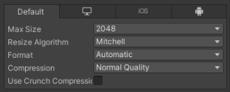

    - Max Size：设置导入的纹理的最大尺寸，即使美术出的很大的图，也可以通过这里把它们限制在一定范围内
    - Resize Algorithm：当纹理尺寸大于指定的Max Size时，使用的缩小算法
      - Mitchell：默认米切尔算法来调整大小，该算法是常用的尺寸缩小算法
      - Bilinear：使用双线性插值来调整大小。如果细节很重要的图片，可以使用它，它比米切尔算法保留的细节更多
    - Format：纹理格式<br>各平台支持的格式有所不同<br>如果选择Automatic<br>会根据平台使用默认设置
      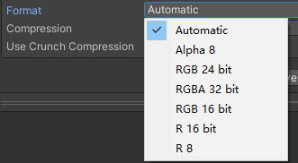

      - 都支持的格式
        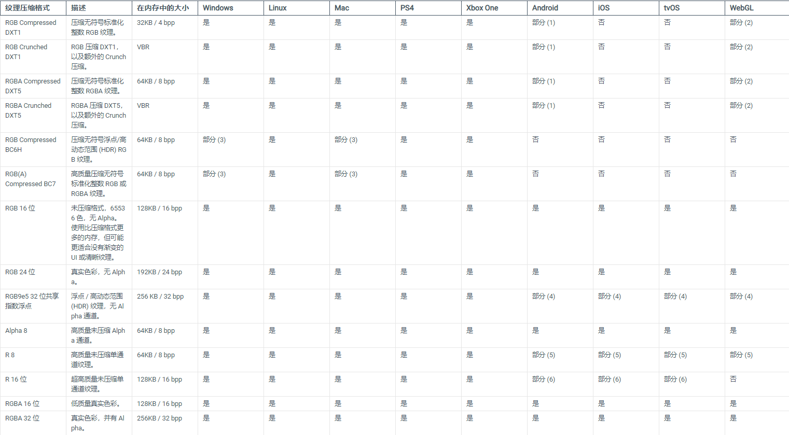

        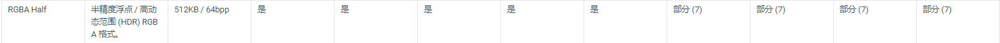

      - 移动端和网页端特有格式
        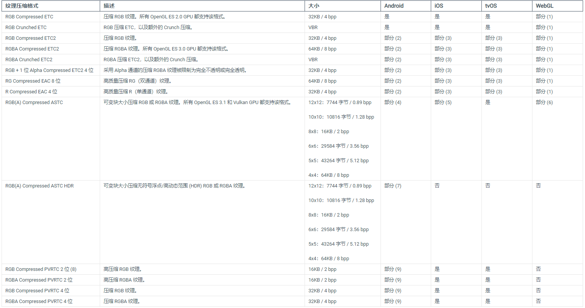

      - 关于格式选择的注意事项<br>根据不同平台单独进行设置
        - IOS
          - 选择默认的纹理压缩设置 (PVRTC) 可获得更大的兼容性。<br>如果您的应用程序不包含 OpenGL ES 2 支持，则可以选择一种 ASTC 格式。这些格式提供更好的质量和灵活性，并且压缩速度比 PVRTC 快。
        - Andorid
          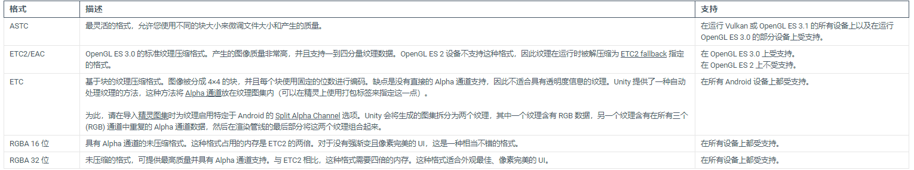

          - 由于安卓设备众多，设备标准都不同意，一般会根据不同的设备标准制作多个安装包<br>1.构建一个以 OpenGL ES 3 为目标的 APK<br>1-1访问 Android 的 Player Settings<br>（菜单：Edit &gt; Project Settings &gt;Player Settings，<br>然后选择 Android 	类别）。<br>1-2.向下滚动到 Graphics APIs 部分。<br>1-3.确保 OpenGL ES 2 不在列表中。<br>1-4.构建 APK<br>（菜单：File &gt; Build Settings，然后单击 Build）。<br>2.构建一个以 OpenGL ES 2 为目标的单独 APK<br>2-1访问 Android Player Settings。<br>2-2.向下滚动到 Graphics APIs 部分。<br>2-3.在列表中添加 OpenGL ES 2<br>并删除 OpenGL ES 3 和 Vulkan。<br>2-4.构建 APK。
    - Compression：<br>选择纹理的压缩类型，帮助Unity正确选择压缩格式<br>会根据平台和压缩格式的可用性进行压缩
      - None：不压缩纹理<br>Low Quality：以低质量格式压缩纹理<br>Normal Quality：以标准格式压缩纹理<br>High Quality：以高质量格式压缩纹理
        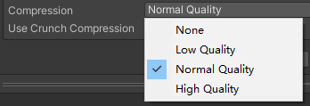

    - Use Crunch Compression：<br>启用后，使用Crunch压缩。Crunch是一种基于DXT或ETC纹理压缩的有损压缩格式。压缩时间长，解压速度快。
      - 压缩质量，质量越高意味着纹理越大，压缩事件越长
        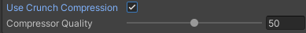

    - Split Alpha Channel：Alpha通道分离，节约内存。会把一张图分成两张纹理。一张包含RGB数据，一张包含Alpha数据，在渲染时再合并渲染。<br>Override ETC2 fallback：不支持ETC2压缩的设备上，使用的格式
      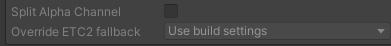

### sprite

- sprite Editor
  - 图片编辑
    - 精灵图片编辑器
    - SpriteEditor
      - 主要用于设置单张图片的基础属性
      - Name：名字
      - Position：在图片中的偏移位置和宽高
      - Border：边框，用于设置九宫格的4条边
      - Pivot：轴心（中心）点位置
      - Pivot Unit Mode：轴心点单位模式<br>Normalized：标准化模式，0~1<br>Pixels：像素模式
        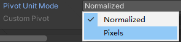

      - Custom Pivot：自定义轴心点
    - CustomOutline
      - 决定渲染区域
      - Snap：将控制点贴近在最近的像素
      - Outline Tolerance：轮廓点的复杂性和准确性，0~1<br>值越大轮廓点越多，越准确
      - Generate：生成网格轮廓
    - CustomPhysicsShape
      - 决定碰撞判断区域
      - 与CustomOutline参数一样
    - SkinEditor
      - 2D骨骼动画
    - SecondaryTexture
      - 与Shader相关
  - sprite Editor Multible
    - 图集元素分割
    - 自动分割
      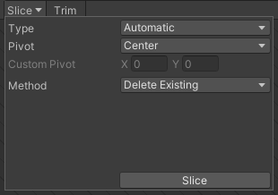

      - Pivot：单张图片轴心点位置
      - Custom Pivot：自定义轴心点
      - Method：如何处理现有对象<br>Delete Existing：替换掉已经选择的任何矩形<br>Smart：尝试创建新矩形同时保留或调整现有矩形<br>Safe：添加新矩形而不更改任何已经存在的矩形
        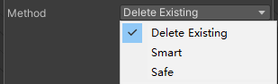

    - 按单元格大小分割
      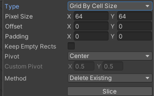

      - Pixel Size：单元格宽高
      - Offset：偏移位置
      - Padding：和边缘的偏移位置
      - Keep Empty Rects：是否保留空矩形
    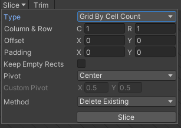

      - Column &amp; Row：行列数
  - polygon多边形编辑
    - 用的少
    - ChangeShape设置有几条边
- sprite Renderer
  - 精灵渲染器，除了UI外2D对象都通过这个组件渲染
  - 可以直接拖入Sprite对象或者创建sprite在Hierarchy得到
  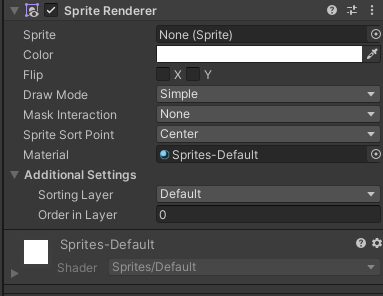

    - Sprite：<br>渲染的精灵图片
    - Color：<br>定义着色，一般没有特殊需求不会修改
    - Filp：<br>水平或竖直翻转精灵图片
    - Draw Mode：<br>绘制模式，当尺寸变化时的缩放方式
      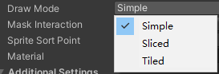

      - Simple：<br>简单模式，缩放时整个图像一起缩放
      - Sliced：<br>切片模式，9宫格切片模式，十字区域缩放，4个角不变化<br>一般用于变化不大的纯色图<br>（注意：需要把精灵的网格类型设置为Full Rect）
      - Tiled：<br>平铺模式，将中间部分进行平铺而不是缩放<br>（注意：需要把精灵的网格类型设置为Full Rect）
        - Continuous：当尺寸变化时，中间部分将均匀平铺<br>Adaptive：当尺寸变化时，类似Simple模式，当更改尺寸达到Stretch Value时，中间才开始平铺
          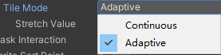

    - Mask Interaction：与精灵遮罩交互时的方式
      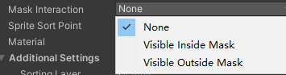

      - None：不与场景中任何精灵遮罩交互
      - Visible inside Mask：精灵遮罩覆盖的地方可见，而遮罩外部不可见
      - Visible Outside Mask：精灵遮罩外部的地方可见，而遮罩覆盖处不可见
    - Sprite Sort Point：计算摄像机和精灵之间距离时，使用精灵中心Center还是轴心点Pivot，一般情况下不用修改
      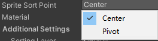

    - Material：材质，可以使用一些自定义材质来显示一些特殊效果<br>一般情况不修改。默认材质是不会受到光照影响的，如果想要受光照影响，可以选择Default-Diffuse
    - Additional Settings：高级设置<br>Sorting Layer：排序层选择<br>Order in Layer：层级序列号，数值越大约会显示在前面
  - 代码设置
    ```csharp
    GameObject obj = new GameObject();
    SpriteRenderer sp = obj.AddComponent<SpriteRenderer>();
    sp.sprite = Resources.Load<Sprite>("名字")；

    //加载图集
    Sprite[] sprs = Resources.LoadAll<Sprite>("图集名字");
    //图集内图片是按顺序放置的，之后可以按顺序加载
    ```

- sprite Creator
  - Unity自己可以用多边形效果生成默认图片
  - 直接在Project中按Create-&gt;sprites创建
- spriteMask
  - 一种隐形图片，让某些图片有相互影响
  - 对于spriteRenderer组件有maskInteraction参数 其中效果有none无关，遮罩内显示，遮罩外显示
  - 参数
    - sprite 给一张图，有颜色的地方才能遮罩
    - AlphaCutoff控制小于参数的alpha值都不会显示
    - CustomRange自定义遮罩范围
      - 要想被遮罩影响，图片索引Layer要大于Back参数，小于Front参数
- sorting Group
  - 排序分组的意思用处是对多个精灵图片控制层级
  - 用法是创建n个带SortingGroup的父对象，在这些父对象上创建对象，就能严格分组
- sprite Atlas
  - unity自带的打图集功能
  - 在左上角-&gt;Edit -&gt; ProjectSetting-&gt;Editor-&gt;spritePacker
  - 选择Alway Enabled，Enabled在运行时打包图集<br>Enabled for Build 做完后生成的exe文件能打包
  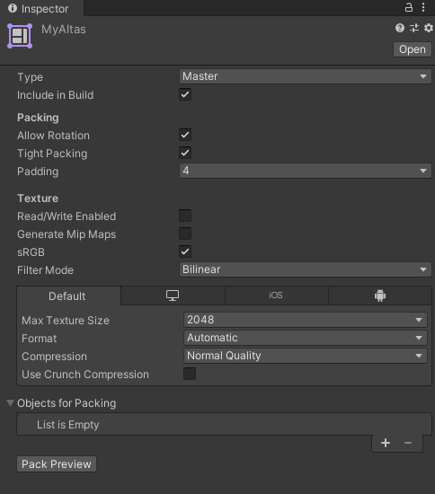

    - Type：图集类型
      - Master：主图集<br>Include in Build：选中可以在当前构建中包含图集<br>Allow Rotation：选中此选项将在打包图集时对图片元素进行旋转，可以最大限度提高组合后的图集密度；注意！！！如果是UI图集，请禁用此选项，因为打包时会将场景中UI元素旋转<br>Tight Packing：选中此选项在打包图集时使用图片轮廓来打包而不是根据矩形，可以最大限度提高组合后的图集密度<br>Padding：图集中各图片的间隔像素
        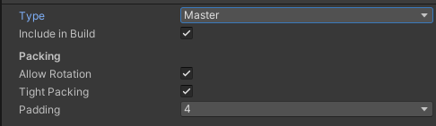

      - Variant：变体类型的图集<br>Master Atlas：关联的主图集（图集类型必须是Master）<br>Include in Build：选中可以在当前构建中包含图集<br>Scale：设置变体图集的缩放因子（0~1），变体图集的大小是主图集乘以Scale的结果<br>变体图集的主要作用是以主图集为基础，对它进行缩放产生一个新的图集副本。如果想使用变体图集中的内容，只需要勾选变体图集的Include in build选项，而主图集禁用此选项即可
        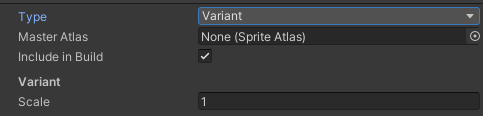

    - Read/Write Enabled：允许通过脚本访问纹理数据。如果启用，会创建纹理数据的副本。会让内存翻倍，一般情况下不需要开启它
    - Generate Mip Maps：勾选它会生成Mipmap；Mipmap是一种性能优化手段，用内存换性能。一般情况下不用开启
    - SRGB：启用此属性可指定将纹理存储在伽马空间中。对于非 HDR 颜色纹理（例如反照率和镜面反射颜色），应始终选中此复选框。如果纹理存储了有特定含义的信息，并且您需要着色器中的确切值（例如，平滑度或金属度），请禁用此属性。默认情况下会启用此属性。
    - Filter Mode：纹理在3D变化拉伸时如何进行过滤<br>Point：纹理靠近时变为块状<br>Bilinear：纹理靠近时变得模糊<br>Trilinear：与Bilinear类似，但是纹理在不同的MIP级别之间模糊
      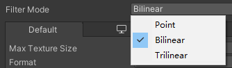

    - Objects for Packing：关联需要打图集的图片们，注意：一定是Sprite类型的图片
    - Default
      - Max Texture Size：纹理的最大尺寸，像素为单位
      - Format：指定纹理的内部表示，在不同平台上会有不同的参数
        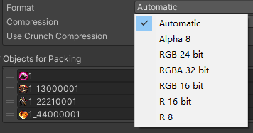

      - Compression：纹理压缩类型<br>不压缩<br>低质量<br>普通质量<br>高质量<br>质量越高占用内存越多，不压缩质量最好
        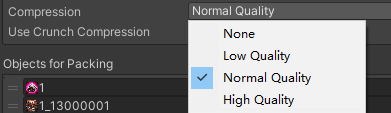

      - Use Crunch Compression：使用Crunch压缩，是一种有损压缩格式，压缩耗时长，但是运行时解压速度快<br>Compressor Quality：压缩质量，质量越高纹理越大，耗时越长
        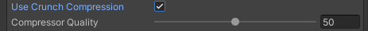

  - 代码控制
    ```csharp
    SpriteAtlas sa = Resources.Load<SpriteAtlas>(名字); //要应用命名空间unityEngine.U2D
    sr.spite = sa.GetSprite("图的名字");
    //直接得到图片
    ```

### 2D物理相关

- 刚体
  - 参数
    - 刚体类型
      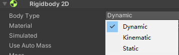

      - Dynamic：动态类型<br>受重力和力的影响移动和旋转
        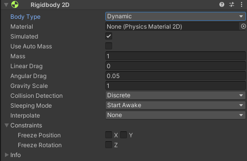

        - Material：<br>物理材质，在刚体上设置了物理材质，如果子物体有碰撞器但是没有设置材质则会通用刚体的物理材质<br>如果不设置，将使用在Physics 2D窗口中设置的默认材质<br>物理材质的使用优先级：<br>1.2D碰撞器上指定的2D物理材质<br>2.2D刚体上指定的2D物理材质<br>3.Physics 2D窗口指定的2D默认物理材质
        - Simulated：<br>如果希望2D刚体以及所有子对象2D碰撞器和2D关节都能模拟物理效果<br>需要启用该选项
        - Use Auto Mass：是否使用自动质量
        - Mass：<br>质量
        - Linear Dray：影响位置移动的阻力系数
        - Angular Drag：影响旋转移动的阻力系数
        - Gravity Scale：受重力影响的程度
        - Collision Detection：碰撞检测算法
          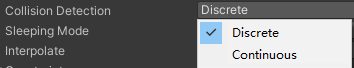

          - Discrete：离散检测算法，只会用新位置进行计算，速度过快时会穿过
          - Continuous：连续检测算法，计算量更大，但是不会发生穿过的情况
        - Sleeping Mode：对象处于静止状态时进入睡眠模式
          

          - Never Sleep：从不休眠，会一直进行检测计算，性能消耗较大
          - Start Awake：最初处于唤醒状态
          - Start Asleep：最初处于睡眠状态，但是可以被碰撞唤醒
        - Interpolate：物理更新间隔之间的插值运算
          

          - None：不应用移动平滑
          - Interpolate：根据前一帧进行平滑处理
          - Extrapolate：根据后一帧位置进行平滑处理
        - Constraints：约束限制<br>可以让某一个轴不受力影响位移或者旋转
      - Kinematic：运动学类型<br>不受力的影响，只能通过代码让其动起来<br>能和Dynamic 2D刚体产生碰撞，但是不会动，只会进入碰撞检测函数<br>因此它没有了质量莫摩擦系数等属性<br>因此它的性能能消耗较低，主要会通过代码来处理其移动旋转
        

        - Simulated：<br>如果希望2D刚体以及所有子对象2D碰撞器和2D关节都能模拟物理效果<br>需要启用该选项<br>当启用时，会充当一个无限质量的不可移动对象，可以和所有2D刚体产生碰撞<br>如果Use Full Kinematic Contacts禁用，它只会和Dynamic 2D刚体碰撞
        - Use Full Kinematic Contacts：如果希望能和所有2D刚体碰撞，启用它<br>如果不启用，它不会和Kinematic 2D和Static 2D刚体碰撞
      - Static：静态类型<br>完全不动的需要检测碰撞的对象<br>相当于是无限质量不可移动的对象<br>它的性能消耗最小，它只能和Dynamic 2D刚体碰撞<br>和它类似的有只加碰撞器而不加刚体的物体<br>它们会和刚体物体产生碰撞，但是自己不会动
        

  - 如何使用
    - 动态刚体
      - 受力的作用，要动要碰撞的对象
    - 运动学刚体
      - 通过api移动的对象，不受力的作用用于碰撞，用于碰撞检测
    - 静态刚体
      - 无法移动的对象，不用于碰撞用于碰撞检测
  - 代码控制
    ```csharp
    Rigidbody2D rg = this.GetComponent<Rigidbody2D>();
    //加力
    rg.AddForce(new Vector2(0,100));
    //速度
    rg.velocity = new Vector2(1,0);
    ```

- 碰撞器
  - 2D碰撞器
    - 1.圆形碰撞器
      - Material：一种物理材质，用于确定碰撞的属性，控制摩擦和弹性<br>Is Trigger：是否是触发器<br>Used By Effector：是否被附加的2D效应器使用<br>Offset：圆心偏移位置<br>Radius：圆形的半径
        

    - 2.盒状碰撞器
      - \`
        

    - 3.多边形碰撞器
      - Points：多边形顶点<br>虽然可以手动修改，但是一般情况下 我们通过数值编辑太复杂了<br>都通过Edit Collider编辑，或者让Unity自动识别创建
        

    - 4.边界碰撞器
      - 边界碰撞器的编辑主要还是通过Edit Collider<br>一般不会手动去通过数值加点
        

    - 5.胶囊碰撞器
      - Size：胶囊的宽高<br>Direction：是竖直胶囊还是水平胶囊
        

    - 6.复合碰撞器
      

        - Geometry Type：几何学类型，合并碰撞体时，碰撞体顶点将组合为两种不同的几何体类型<br>Outlines：空心轮廓，类似边界碰撞器<br>Polygons：实心多边形，类似多边形碰撞器
          

        - Generation Type：生成类型，复合碰撞器在何时生成新几何体<br>Synchronous：对2D复合碰撞器或使用的其它碰撞器修改时，Unity立即生成新几何体<br>Manual：手动生成新几何体，通过代码生成或者点击下发的Regenerate Geometry生成按钮
          

        - Vertex Distance：从复合碰撞器收集顶点时允许的最小间距值
  - 碰撞检测函数
    - 同3D的但后面要加2D<br>OnCollisionEnter2D<br>OnTriggerEnter2D
- 物理材质
  - Friction：摩擦系数，为0表示没有摩擦力<br>Bounciness：反弹程度。0表示没有弹力，1表示完美弹力（没有能量损失一直弹）
- 恒定力
  - 一个持续给力的组件让物体逐渐加速后旋转
  - 脚本名
    - Constant Force 2D
  - Force：物理更新时施加于2D刚体上的线性力<br>Relative Force：物理更新时施加的线性力（相对刚体对象坐标系）<br>Torque：物理更新时施加于2D刚体的扭矩力
    

- 效应器
  - 区域效应器
    - 主要作用：在一个区域内让游戏对象受到力和扭矩力的作用<br>Use Collider Mask：是否启用碰撞器遮罩，如果开启才会出现下面的Collider Mask，可以通过选择层，决定该效应器只会作用于哪些层的对象<br>Use Global Angle：勾选将使用世界坐标系角度，如果不勾选，角度为局部角度<br>Force Angle：施加力的角度<br>Force Magnitude：施加力的大小<br>Force Variation：施加力的随机大小变化 会在Force Magnitude基础上根据该值进行随机变化<br>ForceTarget：效应器在目标对象上施加力的作用点<br>Collider：以碰撞器的当前位置（如果碰撞器有偏移，没有位于质心，可能会产生扭矩力，带来旋转）<br>Rigidbody：以刚体的当前质心（不会产生扭矩力）<br>Drag：阻力<br>Angular Drag：扭矩阻力
      

  - 浮力效应器
    - 主要作用：模拟流体行为，浮动和阻力相关设置，让玩家在该区域看起来像在水里移动<br>Density：流体密度，密度较大，碰撞体会下沉，密度越小碰撞体会上浮<br>密度和流体相同的碰撞体会浮在流体中<br>Surface Level：定义浮力流体的表面位置，对象高于此线时，不会对其施加浮力，以下或者相交会施加浮力。沿世界Y轴偏移<br>Linear Drag：影响对象在水中移动的阻力系数<br>Angular Drag：影响对象在水中旋转的阻力系数<br>Flow Angle：流体流动方向相对世界控件的角度，沿指定方向施加浮力<br>Flow Magnitude：与FlowAngle结合使用，前者决定力的角度，该值确定浮力大小<br>Flow Variation：随机改变流体力的值
      

  - 点效应器
    - 主要作用：模拟磁铁 吸引或者排斥的效果<br>Force Magnitude：施加力的大小<br>Force Variation：施加力的大小变化<br>Distance Scale：效应器和目标之间举例的缩放。计算距离时，会按该比值对距离进行缩放<br>Force Source：力源来自哪个位置，从该点计算距离。<br>Collider：碰撞器的位置<br>Rigidbody：刚体的位置<br>Force Target：作用力目标位置，用改点计算位置<br>Collider：碰撞器的位置，如果碰撞器有偏移，可能会产生扭矩力<br>Rigidbody：刚体的位置，不会产生扭矩力<br>Force Mode：计算力的模式<br>Constant：忽略源和目标之间相隔的距离<br>Inverse Linear：反线性距离计算，距离越远，力的大小呈线性减小<br>Inverse Squared：反平方距离计算，力的大小呈指数减小（按平方下降），类似现实世界重力
      

  - 平台效应器
    - 主要作用：2D游戏当中的平台或可往上跳跃的墙壁<br>Rotational Offset：旋转偏移量，控制平台角度偏移<br>Use One Way：是否使用单向碰撞行为<br>Use One Way Grouping：当平台式有多个碰撞器组合时，可以通过它将所有碰撞器设置为单向碰撞行为<br>Surface Arc：以局部坐标系下向上的方向为中心，填写一个角度值，定义不允许通过的表面，该角度外的其它地方视为单向碰撞<br>Use Side Friction：是否应该在平台两侧使用摩擦<br>Use Side Bounce：是否应该在平台两侧使用弹性<br>Side Arc：用于定义左右两侧平台的响应弧度
      

    - 不需要用Trigger
  - 表面效应器
    - 主要作用：模拟传送带<br>Speed：表面保持的速度<br>Speed Variation：速度的随机增加值<br>Force Scale：缩放沿表面移动时施加的力。如果是0表示不施加力，相当于禁用。值越低越慢，值越高越快，建议不要设置为1，因为当设置为1时可能会抵消施加在物体上的其它力，比如跳跃的力<br>Use Contact Force：是否对接触物体表面的出点施加力，如果选择会让对象旋转，如果不开启则不会旋转<br>Use Friction：是否使用摩擦力<br>Use Bounce：是否使用弹力
      

    - 不需要用Trigger
  - 使用效应器需要加上碰撞器组件，并且勾上使用效应器和Trigger

### spriteshape

- 需要去packageManager中导入2D Sprite Shape
- 在Project文件夹下右键-&gt;create-&gt;2D-&gt;spriteShapeProfile中创建
- Sprite Shape Profile<br>精灵形状概述文件配置
  

  - Use Sprite Borders：是否使用精灵边框，用于九宫格拉伸
  - Texture：用于填充实心部分的纹理（使用的纹理的平铺模式必须是Repeat重复模式）
  - Offset：纹理偏移量
  - 这里的设置主要用于封闭图形<br>在不同角度范围内使用的图片不同<br>可以达到一个封闭效果<br>Angle Ranges：角度范围<br>Start：起始角度<br>End：结束角度<br>Order：Sprite相交时的优先级，优先级高的显示在前面
  - Sprites：指定角度范围内的精灵列表<br>在该角度范围内，可以选择使用的图片资源
  - Corners：指定角显示的精灵图片<br>主要用于封闭图形<br>外部四个角用的图片<br>内部四个角用的图片
- Sprite Shape Renderer<br>Sprite Shape Controller<br>精灵形状渲染器和控制器
  

  - Sprite Shape Renderer<br>精灵形状渲染器<br>该控件主要是控制 材质 颜色 以及和其它Sprite交互时的排序等等信息
    - Color：颜色
    - Mask Interaction：遮罩相互作用规则设置
    - Fill Material和Edge Material：填充材质和边缘材质
    - Sorting Layer和Order in Layer：排序相关
  - Sprite Shape Controller<br>精灵形状控制器
    - Profile：使用的精灵形状概述文件
    - Detail：精灵形状的质量<br>高中低三种质量
      

    - Is Open Ended：是否是开放的，不封闭的
    - Adaptive UV：自适应UV，如果开启，会自动帮助我们判断是平铺还是拉伸<br>开启后只有宽度够才会平铺，如果宽度不够会拉伸<br>不开启始终平铺，但是可能会出现裁剪效果<br>一般根据你的实际效果进行选择
    - Optimize Geometry：优化三角形数量，勾选后会最小化精灵图形中的三角形数量
    - Enable Tangents：是否启用切线计算功能<br>如果你的着色器中需要切线信息参与计算，则勾选
    - Corner Threshold：角阈值，当拐角处的角度达到这个阈值时将使用角图片
    - Stretch UV：是否拉伸UV，如果勾选纹理的UV将伸展到整个精灵形状的直线上
    - Pixel Per Unit：禁用拉伸UV时才有，Unity单位对应多少像素，较高的值会较少纹理的大小
    - Worldspace UV：根据世界控件的UV填充纹理
    - 启用编辑状态后
      

      - Tangent Mode ：切线模式<br>从左至右依次是：<br>顶点模式-点两侧不构成曲线<br>切线模式-点两侧构成曲线，并且可以控制切线弧度<br>左右切线模式-点两侧构成曲线，并且可以分别控制左右两侧切线弧度
      - Position：选中点的局部坐标位置
      - Height：控制点左右两侧精灵图片的高度
      - Corner：是否使用角度图片<br>Disabled：不使用角度图片<br>Automatic：自动
        

      - Sprite Variant：选择使用的精灵图片
      - Snapping：是否开启捕捉设置控制点
  - 生成碰撞器
    - 使用边界碰撞器或多边形碰撞器

### TileMap

- 同样能制作2D地图，相比spriteshape不能做出弧度，但是可以实现伪Z轴
- 需要装2DTileMap包
- 在Create-&gt;2D-&gt;TilePalettte中创建绘图板<br>将图片拖入绘图板中（不是预设体）可以创建单个瓦片接着绘制地图
- TilePalettle
  - 瓦片调色板
    - 创建相关
      ```csharp
      Name：瓦片调色器名称
      Grid：瓦片的网格布局
      	Rectangle：矩形瓦片
      	Hexagon：六边形瓦片
      	Isometric：等距瓦片，单元格为菱形
      	Isometric Z as Y：等距瓦片并且Unity将单元格Z轴转换为局部Y坐标
      Hexagon Type：六边形瓦片地图类型
      	Point Top：点朝顶部的六边形
      	Flat Top：面朝顶部的六边形
      Cell Size：瓦片绘制到单元格的大小
      	Automatic：基于瓦片资源的精灵大小自动设置
      	Manual：自定义大小
      ```

    - 操作技巧
      - 单击瓦片——选择瓦片
      - 在多个瓦片上移动——选择多个瓦片
      - Alt+左键拖动——平移
      - 滚轮键拖动——平移
      - 旋转滚轮键——放大/缩小
    - 面板相关
      

      

        

          - 瓦片地图中有多层时，可以再这里选择层级进行绘制
          

        

          - 选择工具（S）
        

          - 移动工具（M）
        

          - 画笔工具（B）
            - 使用选取器后会自动切换到画笔工具，单个填充
        

          - 框填工具（U）
            - 使用选取器后再切换到框填工具，范围填充
        

          - 选取器工具（I）
            - 选取填充样本
        

          - 橡皮擦工具（D或者使用画笔工具时按住Shift）
            - 单个擦除
        

          - 填充工具（G）
            - 使用选取器后再切换到填充工具，批量填充
    - 快速编辑TileMap
      - 创建一个TileMap然后把所有图全部放进去，在场景上创建新的TileMap，用调色板的文件吸出来放到场景上
      - 对于有伪z轴菱形
        - 我们要修改图像的中心点使得中心在最上表面的中心<br>或者通过笔刷的功能，可以把LockZPosition删掉，可以修改高度
        - 层级有问题，我们要在 Edit-&gt;ProjectSetting-&gt;Graphics-&gt;CameraSetting中把排序改成CustomAxis，数值为X：0，Y:1，Z：-0.26<br>并且回到TileMap把TileMapRenderer中模式改成第二种
        - 角色为了防止有问题，轴心点要放到脚上
        - 最好用排序层的方式显示，在玩家脚上的层级低于玩家，挡住玩家的层级高于玩家
        - 如果想要有树的效果在玩家后面不挡，前面档，则放在玩家同层（一定要把排序点设成轴心点）
    - 参数相关
      

        - Cell Size：网格单元格的大小
        - Cell Gap：网格之间的间隔大小
        - Cell Layout：网格单元的形状和排列<br>Rectangle：矩形<br>Hexagon：六边形<br>Isometric：等距布局，单元格为菱形<br>Isometric Z as Y：等距布局，但Unity将单元格Z轴转换为局部Y坐标（可以改变物体的伪z轴）
          

        - Cell Swizzle：Unity将XYZ单元格坐标重新排序为你选择的类型
      

        - Animation Frame Rate：Unity播放瓦片动画的速率。相当于倍速
        - Color：瓦片色调颜色
        - Tile Anchor：瓦片的锚点偏移
        - Orientation：瓦片地图上瓦片的方向。相当于2D平面使用的是Unity中的哪两个轴
      

        - Sort Order：设置所选瓦片地图上的瓦片排序方向
        - Mode：渲染器的渲染模式<br>Chunk：按位置对瓦片进行分组，并将瓦片精灵一起批处理进行渲染，性能较好<br>Individual：单独渲染每个瓦片，会考虑他们的位置和排序顺序。会让瓦片精灵和场景中其它渲染器或自定义排序轴进行交互
        - Detect Chunk Culling：渲染器如何剔除瓦片地图的边界<br>Auto：自动检测<br>Manual：手动设置拓展边界
        - Chunk Culling Bounds：当选择手动设置剔除拓展边界时，可以在这里自己填写拓展的值
      - 碰撞器，在Tilemap中加上TileMap Collider 2D，需要在Tile中把Collider Type设置 Sprite是按边缘生成，None是没有，Gird是填满
    - 扩展功能
      - [2022版直接在Packagemanager装就好了](https://github.com/Unity-Technologies/2d-extras)
      - 规则瓦片<br>Rule Tile<br>(Hexagonal、Isometric)
        - Default Sprite：默认图片<br>Default GameObject ：默认游戏对象<br>Default Collider：默认碰撞器规则<br>Tiling Rules：平铺规则 可以自己添加删除
          

      - 动画瓦片<br>Animated Tile
        - Number Of Animated Sprites：动画有多少张图构成<br>Minimum Speed：最小播放速度<br>Maximum Speed：最大播放速度<br>Start Time：开始播放的时间<br>Strat Frame：从那一帧开始播放
          

      - 管道瓦片<br>Pipeline Tile
        - None：一个都不相邻时使用的图片<br>One——Four：相邻1~4个时使用的图片
          

      - 随机瓦片<br>Random Tile
        - Number Of Sprites：随机图片数量（之后会随机取一个图片来使用）
          

      - 地形瓦片<br>TerrainTile
        - Filled:填满<br>Three Sides:三个面<br>Two Sides and One Corner:两面一角<br>Two Adjacent Sides:相邻两侧<br>Two Opposite Sides:两个相对的侧面<br>One Side and Two Corners:一侧和两个角<br>One Side and One Upper Corner:一边和上角<br>One Side:一面<br>Four Corners:四个角<br>Three Corners:三个角<br>Two Adjacent Corners:两个相邻角<br>Two Opposite Corners：两个相反的角<br>One Corner：一个角<br>Empty：空
          

- 代码控制
  - 引用命名空间UnityEngine.Tilemaps
  ```csharp
  public Tilemap map//得到瓦片格子
  public Grid grid // 进行坐标转换
  public TileBase tilebase //基类，传入单个瓦片资源

  //清空瓦片地图
  map.ClearAllTiles();
  //获取指定坐标格子
  TileBase tb = map.GetTile(new Vector3Int(0,0,0));
  //设置删除瓦片, tilebase为空就是删除
  map.SetTile(new Vector3Int(1,1,1),tilebase);
  map.SetTiles(Vector3Int数组,tilebase数组);
  map.SwapTile(tileBase1,tileBase2);//把所有TileBase1的格子替换成Tilebase2
  gird.WorldToCell(世界坐标)//世界坐标转格子坐标
  ```

## 导航寻路系统

### 导航系统是对AStar的扩展和优化

### 要下载AI Navigation包

### 导航网格生成

- 导航网格窗口
  - Window -&gt;AI -&gt; Navigation
  - Agents 设置寻路代理信息<br>Areas 导航地区页签，设置对象寻路消耗
  - 参数相关
    - Ojbect<br>场景对象设置页签
      

      - Sceme Filter：<br>场景过滤器，配合Hierarchy窗口使用<br>All：显示场景上所有对象<br>MeshRenderers：显示挂载的网格渲染器的对象<br>Terrains：显示挂载了地形脚本的对象
      - Navigation Static<br>导航静态物体开关
      - Generate OffMeshLinks<br>生成网格连接点开关
      - Navigation Area<br>导航区域选择，配合Areas页签使用
    - Bake<br>导航数据烘焙页签
      

      - Agent Radius<br>代理半径<br>决定了烘焙边缘精确度<br>控制平台可行走区域和边缘可行走区域
      - Agent Height<br>代理高度<br>决定了烘焙高度精确度<br>控制拱桥是否可以穿越
      - Max Slope<br>最大坡度<br>斜坡度数<br>决定了斜坡是否可以行走
      - Step Height<br>最小楼梯高度<br>决定了台阶是否可以行走
      - Generated off mesh Links<br>生成非网格连接<br>两个分开的网格之间连接相关设置
        - Drop Height<br>掉落高度<br>可以从这个高度掉下来
        - Jump Distance<br>跳跃距离<br>决定不同平面上的跳跃距离
      - Advanced
        - Manual Voxel Size<br>手动设置立体像素大小
          - Voxel Size<br>开启前者后可以在这里设置立体像素大小<br>可以控制烘焙的准确度<br>立体像素大小描述了生成的导航网格表示场景几何体的准确程度
          - 注意：立体像素大小减半会使内存使用量增加4倍，构建时间也增加4倍<br>一般情况下不需要修改这个值<br>除非想要极其准确的导航网格
        - Min Region Area<br>最小区域面积<br>当面积小于此处值的导航网格区域会被移除
        - Height Mesh<br>高度网格构建开关<br>主要用来解决楼梯烘焙为斜坡时<br>希望在楼梯表面的位置准确的放置在楼梯平面上<br>而不是斜坡上<br>启用它会增加烘焙时间
    - Areas<br>导航地区页签<br>配合Object页签使用
      

      - Name<br>区域名字
      - Cost<br>寻路消耗
    - Agents<br>代理页签<br>用于配置寻路代理信息
      

- 导航网格寻路组件
  - NavMashAgent
  - 参数相关
    

      - Agent Type<br>代理类型<br>配合Agents页签使用
      - Base Offset<br>基础偏移值，相对对象轴心点的高度偏移
      - Steering<br>移动设置
        - Speed<br>寻路时的最大移动速度（世界单位/秒）
        - Angular Speed<br>寻路时转身的最大旋转速度（度/秒）
        - Acceleration<br>最大加速度（世界单位/平方秒）
        - Stopping Distance<br>当靠近目标点多少距离时，停止运动
        - Auto Braking<br>自动制动（减速）<br>启用后，当到达目标时将减速，如果存在连续移动（比如巡逻移动）建议不要开启该选项
      - Obstacle Avoidance<br>避障设置
        - Radius<br>半径，用于计算障碍物和其它寻路对象之间的碰撞
        - Height<br>高度，通过头顶障碍物时用于计算高度间隙使用
        - Quality<br>障碍躲避品质，越高躲避障碍越准确，但是性能消耗较大，如果不想主动避开其它动态障碍，可以设置为无，则只会解析碰撞
        - Priority<br>优先级，0~99， 避障时，数字较小的障碍物表示较高的优先级<br>优先级低的会忽略避障
      - Path Finding<br>路径寻找规则
        - Auto Traverse OffMesh Link<br>是否开启自动遍历网格外的其它网格连接<br>如果要自定义判断，则关闭此功能
        - Auto Repath<br>是否开启自动重设路线<br>如果开启，当到达路径后段时会再次尝试寻路，当没有到达目标的路径时，会生成一条到达与目标位置最近的可达点
        - Area Mask<br>寻路时，考虑的区域<br>如果寻路时不想考虑某些区域，则取消选中<br>塔防游戏中常见的功能
  - 代码相关
    - 应用命名空间 UnityEngine.AI
    - 常用
      ```csharp
      agent.SetDestination( );
      //自动寻路
      agent.isStoped( );
      //停止寻路
      ```

    - 不常用
      - agent.speed/angularSpeed(速度加速度)
      - agent.hasPath//是否有路径
      - agent.destination//距离
      - agent.path(枚举类型)表达是否成功，有效
      - agent.PathPending//是否计算中
      - agent.updatePosition//是否移动<br>agent.updateLotation//是否旋转
      - agent.velocity(当前速度)
      - 方法
        ```csharp
        if(agent.CalculatePath(Vector3(目标点),NavMeshPath(导出的路径)))
        {
        	返回bool表示是否找到
        }
        ```

        - agent.SetPath(NavMeshPath)<br>//按照设置的路径行走
        - aagent.Warp(Vector3)//瞬间移动到某个点

### 网格外连接组件

- 再烘焙时生成网格外连接，但是是满足条件都会生成，我们需要网格外连接组件生成指定条路径
- 使用
  - 使用两个对象作为两个平面连接点（起点和终点）<br>添加off Mesh Link关联<br>设置参数
  - 网格外连接组件
    

    - Start<br>起始点
    - End<br>结束点
    - Cost Override<br>覆盖消耗值<br>负数或0则使用所属Area区域中的消耗值<br>如果为正数，则使用Area区域寻路消耗值\*正数代表该连接点的寻路消耗<br>相当于我们可以自定义连接点的寻路消耗<br>主要用来解决当有"步行"和连接点都可以到达某一个目标时，希望优先选择步行区域，但是步行路径明显更远时修改该值
    - Bi Directional<br>是否开启双向连接点<br>开启后可以从Start到End，反之也可以<br>如果关闭，则只能Start到End
    - Activated<br>是否启用该连接点<br>如果关闭，则自动寻路时相当于失效
    - Auto Update Positions<br>是否自动更新位置<br>如果启用<br>当开始和结束位置改变时，导航网格也将更新<br>如果不启用，即使改变了开始结束位置，也会按照刚开始的位置进行计算

### 动态障碍组件

- 场景上有些组件是可破坏的，需要动态修改地图
- 使用
  - 为需要动态阻挡的对象添加NavMeshObstacle组件<br>设置参数<br>代码控制其移动后或显隐
  - 参数相关
    - 导航网格动态障碍物组件
      

      - Shape<br>动态障碍的形状<br>Capsule：胶囊<br>Box：盒装
        

      - Carve：<br>是否开启雕刻功能<br>开启后，障碍物会在导航网格中挖一个孔，所谓挖孔就是会生成对应的网格信息，认为这篇区域无法前往<br>如果动态障碍物是固定不动的，建议开启，比如阻碍物门木桶栅栏等等<br>如果动态障碍物是频繁移动的，建议不开启该功能，比如汽车和玩家
        - Move Threshold：<br>移动阈值<br>当障碍物移动超过该距离时，会认为其为移动状态，会更新移动的孔
        - Time To Stationary：<br>障碍物作为静止状态需要等待的时间，单位为秒<br>当静止时间超过该值会认为真正静止了
        - Carve Only Stationary：<br>只有在静止状态时才会计算孔
