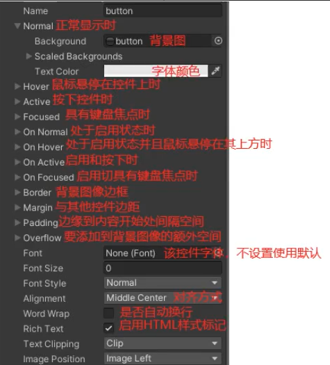
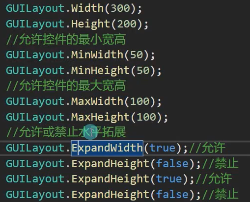
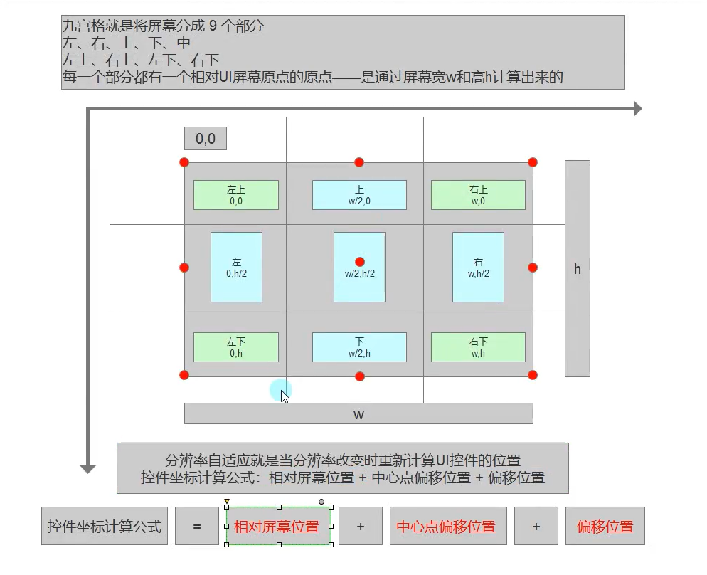

# unity GUI

## 基础控件

### GUI工作原理和作用

- GUI 及时模式游戏用户交互界面<br>代码驱动UI系统，运行游戏才能显示
- 作用调试工具<br>给脚本创建自定义面板<br>扩展Unity<br>不要作为游戏UI
- 工作原理
  - 类似生命周期函数，写在继承Mono类里
    ```csharp
    private void OnGUI( )
    {

    }
    ```

  - 注意
    - 每帧进行 相当于绘制GUI界面函数
    - 一般只执行GUI相关界面和逻辑
    - 函数在OnDisable之前 LateUpdate之后执行
    - 继承Mono类的脚本才能绘制

### 文本和按钮控件

- GUI控件共同点
  - 他们都是GUI公共类中提供的静态函数 直接调用即可
  - 位置参数：Rect参数  x y位置 w h尺寸<br>显示文本：string参数<br>图片信息：Texture参数<br>综合信息：GUIContent参数<br>自定义样式：GUIStyle参数
  - 每一种控件都有多种重载，都是各个参数的排列组合<br>必备的参数内容 是 位置信息和显示信息
- 文本
  - GUI.Label(new Rect( x, y, w, h) , "string");<br>GUI.Label(new Rect( x, y, w, h) , Texture类); Texture是图片类
    - Rect中x= 0，y = 0是左上角<br>w,h最大只能到图片大小，不能放大图片但能缩小
  - 综合信息
    - GUI.Label(rect, GUIContent)
    - Content是综合信息，能放图加字
    - tooltrip不显示，是一个提示信息
      - GUI.tooltip可以得到鼠标指向的GUI控件的隐藏信息
  - 自定义样式GUIStyle
    

- 按钮
  - GUI.Button(rect,string/texture/GUIContent , GUIstyle)
  - Button 有bool返回值 可用在if内<br>按下加抬起才算一次点击
    - 猜测，按钮默认为false，只有从按钮抬起鼠标才算true<br>类似Input.GetMouseButtonUp( )
  - 长按按钮<br>GUI.RepeatButton( rect,string/texture/GUIContent , GUIstyle)
    - 按钮默认返回false，按下就返回true<br>类似Input.GetMouseButton( )

### 多选框和单选框

- 多选框
  - 普通样式
    - isRight =  GUI.Toggle(rect, isRight(bool值，表示是否选中), string/Texture/GUIContent ， GUIStyle)<br>//返回bool值
  - 自定义样式
    - 多选框只有Normal 和On Noemal两个状态，只要设置这两处图片
    - 图片默认rect大小，需要修改fixedHeight和fixedWidth
    - 文字默认最左边，用padding自定义位置
- 单选框基于单选框实现
  ```csharp
  int index = 1;
  if(GUI.Toggle(new Rect(0, 0, 100, 30), index == 1, "num1"))
      index = 1;
  if(GUI.Toggle(new Rect(0, 40, 100, 30), index == 2, "num2"))
      index = 2;
  if(GUI.Toggle(new Rect(0, 80,100, 30), index == 3, "num3"))
      index = 3;
  ```

  - 用index表示选项
- 面板之间相互控制
  - 写一个OnGUI中用bool控制
  - 挂不同对象上，控制对象失活激活（单例模式）
    - 用单例模式设置静态方法，静态变量
    - 在Awake时初始化单例模式，需要使用单例模式一开始一定要激活

### 输入框和拖动条

- 普通输入
  ```csharp
  string s;
  s = GUI.TextField(rect, s(显示输入内容), int maxLength ,GUIstyle)
  ```

- 密码输入
  ```csharp
  string s;
  s = GUI.PasswordField(rect, s , '*'(替代符) , int(最大长度)， GUIstyle)
  ```

- 水平拖动条
  ```csharp
  float value;
  value = GUI.HorizontalSlider(rect , value(当前值)， leftValue(左边值)，rightValue(右边值)，GUIstyle(条) ,GUIstyle(按钮))
  ```

- 竖直拖动条
  ```csharp
  float value;
  value = GUI.VerticalSlider(rect , value(当前值)， leftValue(左边值)，rightValue(右边值)，GUIstyle(条) ,GUIstyle(按钮))
  ```

### 图片绘制和框

- 图片绘制
  - GUI.DrawTexture(rect,Texture)
  - 改变图片大小会拉伸
  - 其他变量<br>ScaleMode mode（直接拉伸，固定宽高比切割，固定宽高比不裁剪）<br>bool alphaValue （保持透明位置透明，默认true）<br>float wh （强行控制宽高比）
- 框绘制
  - GUI.Box(Rect,string)
  - 做一个底

## 复合控件

### 工具栏和选择网格

- 工具栏（类似单选框）
  ```csharp
  int index;
  index = GUI.Toolbar(rect , index(当前选择的选项) ,string[]/Texture[]/GUIcontent[])
  ```

  - 配合switch执行逻辑
- 选择网格（与工具栏基本一样）
  ```csharp
  int index；
  index = GUI.SelectionGrid(rect , index ,string[]/Texture[]/GUIcontent[] , int x(水平方向最多显示数量) )
  ```

### 滚动视图和分组

- 分组
  ```csharp
  GUI.BeginGroup(Rect);
  其他gui控件
  GUI.EndGroup();
  ```

  - 其他gui控件会随着Group移动而移动
- 滚动列表
  ```csharp
  vector2 nowPos; // 记录当前位置
  nowPos = GUI.BeginScrollView(rect//可见范围, nowPos , rect//内容大小)
  GUI组件（位置是相对滚动条的位置)
  GUI.EndScrollView( );
  ```

### 窗口

- GUI.Window(id(编号) , rect, 委托函数（传函数也行,变量要带id）,string )
  - 第一个id是窗口唯一id<br>委托函数是绘制窗口的函数
- 模态窗口<br>该窗口在最上层，其他案件都点不到了<br>警告或提示
  - GUI.ModalWindow(id(编号) , rect, 委托函数（传函数也行,变量要带id）,string )
- 拖动窗口<br>可以移动
  ```csharp
  Window有Rect返回值
  rect = GUI.Window(id(编号) , rect, 委托函数（传函数也行,变量要带id）,string )
  在函数里面写API：GUI.DragWindow( ); //如果传入参数决定那一部分可以被拖动，默认所有位置都能拖
  ```

## 自定义

### guiskin

- 全局颜色
  - GUI.color = Color.red<br>全局颜色，影响背景和文学颜色
- 皮肤
  - GUI.skin = GUISkin guiskin；//给默认皮肤
  - Project中可以新建GUI Skin文件，内容与GUIStyle完全相似

### GUILayout

- 自动布局
  - GUILayout与GUI相似家了自动布局（不用写Rect）<br>快速布局，不要写游戏UI，写编辑器
  - 默认竖直绘制
  - 水平绘制
    - GUILayout.BeginHorizontal( )；<br>GUILayout组件<br>GUILayout.EndHorizontal( )；
  - 和GUI.Group配合使用
- 自动布局选项
  - GUILayout填入变量中有一个GUILayoutOption变量，他无法new，只能用这些函数
  

## 额外知识点

### 编译模式下运行指定代码

- 脚本类名前加一个特性<br>\[ExcuteAlways\]
- 平时别乱加

### 九宫格


