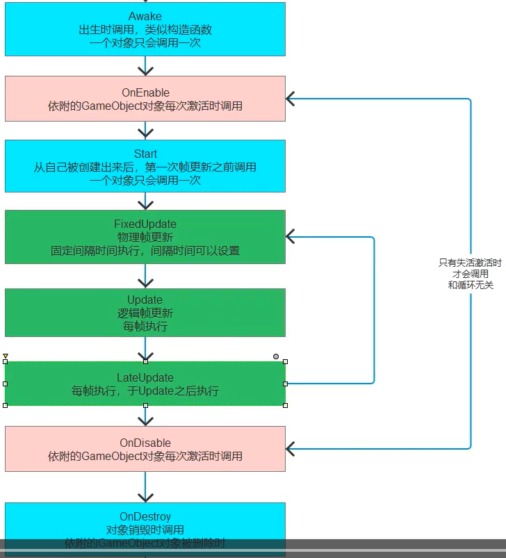
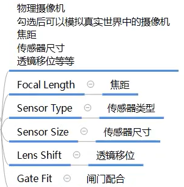
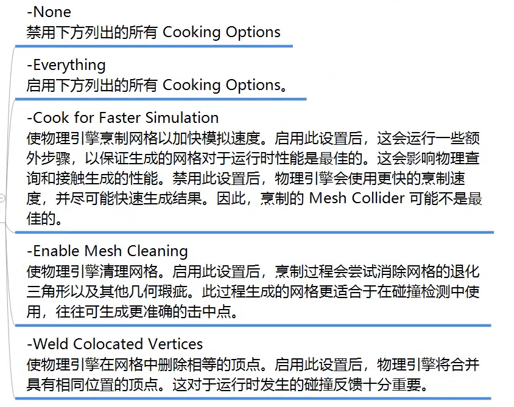
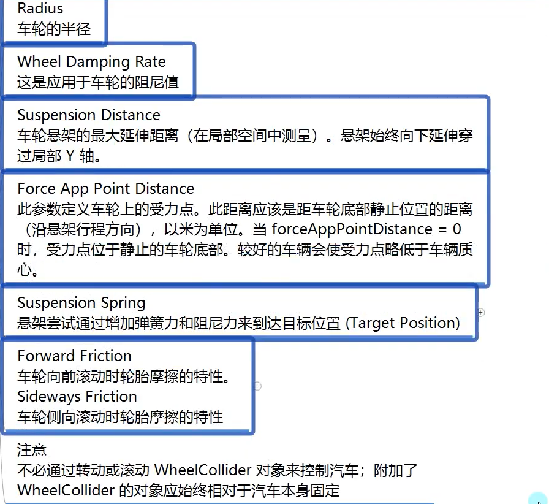
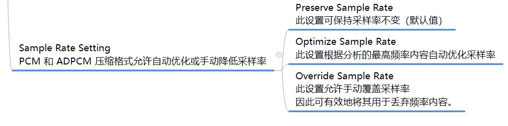
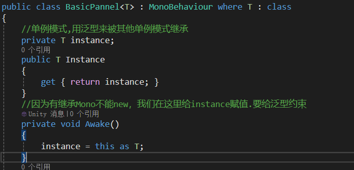

# unity入门

## 界面与原理

### 父对象和子对象

- 子对象随着父对象变化而变化
- 子对象transform是相对父对象的

### 游戏场景

- 游戏可以有多个场景，可以相互叠加（通常用于拷贝GameObject）
- 本质
  - 配置文件，可用记事本打开
  - 运行游戏时就是用反射来从游戏场景得到值

### 预设体和资源包

- 预设体prefab
  - 直接把场景的对象拖到Assets中

## 脚本

### 基本规则

- 创建规则
  - 不在VS中创建
  - 放在Assets中
  - 类名和文件名必须一致（反射用文件名找Type）
  - 不要中文名，中文路径
  - 默认继承MonoBehavior
- MonoBehavior
  - 默认继承，继承了才能挂载到GameObject上
  - 继承了不能new只能挂
  - 继承了就不写构造函数，因为不能new
  - 可以在一个对象挂多个（没有加【DisallowMultipleCompomemt】）
  - 继承了MonoBehavior类的类可以再次被继承
- 不继承MonoBehavior类
  - 不能挂载GameObject上
  - 想怎么写就怎么写，要自己new
  - 一般是单例模式或数据结构类
- 执行先后顺序
  - 脚本中的Execution Order
    - 数字越小越先执行

### 生命周期函数



  - Awake( )类似构造函数，当脚本类创建时执行
  - OnEnable( ) GameObject激活时执行（激活和隐藏）
  - Start( ) 脚本类创建后，下一帧执行一次
  - FixUpdate( ),物理帧更新，每帧执行，和游戏帧不同（可调）
  - Update( )，核心逻辑更新的，每帧执行
  - LateUpdate( ),晚于Update，一般用于摄像机
  - OnDisable( ) GameObject失活时执行（）其他对象都会停止
  - OnDistory( ) 销毁时执行（删除）
- Unity打印信息
  ```csharp
  Debug.Log("");
  DeBug.LogError("");
  DeBug.LogWarning("");
  ```

  - print("");
- 支持继承和多态

### Inspector窗口可编辑变量

- 就是脚本的成员变量
- private和protected无法显示编辑
- 如何让private和protected显示
  - 用特性\[SerializeField\]
  - 强制序列化字段特性
- 公共的不让显示
  - 加特性\[HideInInspector\]
- 大部分类型都能编辑；Dictionary，class，struct不行
  - 自定义的class和struct可以在写他们前加特性\[System.Serializable\]显示
- 特性
  - \[Header(" ")\]说明
  - \[Tooltip(" ")\]注释
  - \[Space( )\]间隔
  - \[Range(min,max)\]数值滑块
  - \[Multiline(4)\]多行显示字符串
  - \[TextArea(3,4)\]滚动条显示字符串
  - \[ContextMenuItem("显示方法名","方法名")\]添加快捷执行函数的按钮
  - \[ContextMenu("")\]为方法加特性
- 注意
  - Inspector上就是成员变量，改了就是改代码上的值
  - 拖到Gameobject对象上的不会被改默认值影响
  - 运行中修改信息不会保存

### mono中重要内容

- 成员
  - 获取依附的GameObject
    - gameObject
    - 可以通过拖动的形式得到其他对象的gameObject
  - 获取依附的GameObject的位置
    - transform.position//位置<br>transform.eulerAngles//角度<br>transform.lossyScale//缩放
    - this.gameObject.transfrom(不简写)
  - 获取脚本是否激活
    - enabled（bool型）
- 方法（得到依附对象上其他脚本）
  - 得到自己挂载的单个脚本
    - 脚本名 c = this.GetComponent("脚本名")；（得到Component类用as转换）
    - 脚本名 c = this.GetComponent(typeof(脚本名)) as 脚本名；
    - 脚本名 c = this.GetComponent&lt;脚本名&gt;( )；
  - 得到多个脚本
    - 脚本名\[ \] arr = this.GetComponents&lt;脚本名&gt;( );
  - 得到子对象上的脚本（默认也会找自己身上的）
    - this.GetComponentInChildren&lt;&gt;( )
    - 函数默认是有一个参数的默认是false<br>意思是子对象失活会不会进行查找true表示会找
    - 能找到子对象的子对象
  - 得到父对象上的脚本（默认也会找自己身上的）
    - this.GetComponentInParent&lt;&gt;( )
    - 函数默认是有一个参数的默认是false<br>意思是子对象失活会不会进行查找true表示会找
  - 尝试获取脚本
    ```csharp
    脚本名 t；
    this.TryGetComponent<脚本名>(out t);
    //没得到默认为null，可把他放入if判断，逻辑写if内
    ```

## 重要组件及api

### GameObject

- 成员
  - this.gameObject.name(对象名字)
  - this.gameObject.activeSelf（对象是否激活）与enable（指脚本）区分
  - this.gameObject.isStatic（是否静态）
  - this.gameObject.layer（层级int）
  - this.gameObject.tag（标签）
  - this.gameObject.transform（与this.transform相同）
- 静态方法
  - 创建几何体
    ```csharp
    GameObject.CreatePrimitive(PrimitiveType.Cube);
    (有GameObject返回值，返回值是创建的立方体，可对它进行后续操作)
    ```

    - 对于得到的GameObject对象，可以得到任何脚本信息（obj.GetComponent）
  - 查找对象
    - 1.通过名字找
      - GameObject obj = GameObject.Find("名字")<br>//效率低下，要遍历，没找到返回null,失活找不到
    - 2.通过tag找
      - GameObject obj = GameObject.FindWithTag("Tagname")<br>//没找到返回null,失活找不到，有多个同名或同tag，随机返回
    - 直接在外面建立public空对象来拖（准确）
  - 找多个对象
    - GameObject\[\] obj = GameObject.FindGameObjectsWithTag("Tagname");
    - 题外话：unity的Object在命名空间UnityEngine中继承了object
  - 实例化对象
    - 根据一个GameObject对象，创建一个复制体（包括脚本）
    - GameObject.Instantiate(obj)	//obj表示被克隆的GameObject，返回值是GameObject可以存起来或操作
    - 通过预设体或场景内对象拖到脚本的空GameObject动态创建
    - 如果继承了Mono，可以不要GameObject直接用
  - 删除对象
    ```csharp
    GameObject.Destory(obj);	//obj表示需删除对象
    ```

    ```csharp
    重载	GameObject.Destory(obj, 5);	//obj表示需删除对象,延迟5秒删
    ```

    - 不仅能删对象，还能删脚本
    - 不是马上移除，只会在合适时间移除，至少一帧
    - GameObject.DestroyImmediate( ); //立即移除，可能卡顿
    ```csharp
    默认情况下，换场景会把对象全移除了
    Gamebject.DontDestroyOnLoad(this.GameObject);防止移除
    ```

- 成员方法
  - 创建空物体
    - GameObject obj = new  GameObject("物体名字");
    - GameObject obj = new  GameObject("物体名字"，typeof(脚本1)，typeof(脚本2));
  - 为对象加脚本
    ```csharp
    obj.AddComponent(typrof(脚本1));	返回值是Component
    ```

    ```csharp
    obj.AddComponent<脚本1>( );	 返回值是脚本
    ```

  - 得到脚本
    - obj.GetComponent&lt;&gt;( );
    - 和继承mono类得脚本一样
  - 标签比较
    - this.gameObject.CompareTag("Tagname")
    - 返回bool值
  - 失活激活
    ```csharp
    obj.SetActive(false);	true是激活
    ```

  - 次要的（不建议用）
    - 广播
      - obj.SendMessage("函数名");
      - 通过广播让obj去找自己所有脚本，找并执行写的函数（所有的）
      ```csharp
      obj.SendMessageUpwards("函数名"); 	//让自己与父对象执行
      ```

      ```csharp
      obj.BroadcastMessage("函数名"); 	//让自己与子对象执行
      ```

### 时间相关

- 时间缩放
  - Time
  - 时间停止
    - Time.Scale = 0;
  - 正常速度
    - Time.Scale = 1;
  - n倍数
    - Time.Scale = n;
- 帧间隔时间
  - 最近的一帧用多长时间（秒）<br>用来计算位移（路程 = 时间 \* 速度）
  - 受scale影响
    - Time.deltaTime  (float)
  - 不受scale影响
    - Time.unscaleDeltaTime   (float)
- 物理帧间隔时间
  - 受scale影响
    - Time.fixedDeltaTime  (float)
  - 不受scale影响
    - Time.fixedUnscaleDeltaTime  (float)
- 计时
  - Time.time
    - 计时
  - Time.unscaleTime

### Transform

- vector3
  - Vector3是一个点或向量是结构体
  ```csharp
  Vector3 v = new Vector3(10,10,10 );
  \\第三个默认为0
  ```

  - 基本运算 + - \* / == !=对应的xyz加减乘除只能数乘
  - 常用坐标如Vector.zreo,Vector.forward(0,0,1)
  - 距离Vector3.Distance(v1,v2);
- 位置
  - this.transform.position<br>//如果你是子对象，你的值还是世界坐标的位置，与面板看到的父对象相对位置无关
  - this.transform.localPosition<br>相对父对象的坐标
  - 位置不能单独改xyz某一个坐标，只能用Vector3来改
  - 如何获取对象当前的正朝向
    - this.transform.forward
    - this.transform.up //对象当前的头顶朝向
- 位移
  - 方向 \* 速度 \* 时间
  - 计算
    - 自己算
      ```csharp
      this.transform.position += this.transform.forward * speed * Time.deltaTime;
      往自己前方移动
      ```

    - API
      - this.transform.Translate(参数1)<br>参数表示相对坐标系路程
      - this.transform.Translate(Vector3.forward \* speed \* Time.detlaTime)<br>往自己前方移动
      - this.transform.Translate(Vector3.forward \* speed \* Time.detlaTime , Space.World )<br>相对于世界坐标系动
- 角度
  - this.transform.rotation<br>//4元数
  - this.transform.eulerAngles<br>//界面显示的角度（Vector3类型）
    - this.transform.localEulerAngles<br>//相对父对象角度
  - 计算
    - 算法和位置相同，不停加（Vector3/this.transform.up \* detlaTime \* speed）
    - API
      - 自转
        - this.transform.Rotate(new Vector3(0,1,0) \* detlaTime  \* speed) 自己坐标轴自转
        - this.transform.Rotate(new Vector3(0,1,0) \* detlaTime  \* speed , Space.World)世界坐标轴自转
        - this.transform.Rotate(Vector3.right, detlaTime \* 10 , Space.World)<br>参数1：选个轴	参数2：选个速度	参数3：基于自己还是世界
      - 绕着某点转
        - this.transform.RotateAround(Vector3.zreo , Vector3.up , detlaTime \* 10)<br>参数1：选个点	参数2：点的轴	参数3：转动速度
  - eulerAngle只能得到0~360度之间的度数，与界面显示不同
- 缩放和看向
  - 相对世界的缩放
    - this.transform.lossyScale
    - 只能得不能改
  - 相对父对象缩放
    - this.transform.localScale
    - 能改
  - 看向
    - this.transform.LookAt(要看的坐标)
- 父子关系
  - 获取和设置父对象
    - this.transform.parent 父对象，设置为null表示断绝父子关系
    - 认爹
      - this.transform.parent = GameObject.Find("name").transform;
      - this.transform.SetParent(GameObject.Find("name").transform,true)<br>参数1：父亲	参数2：是否保留原本坐标，位置，大小，填false会把相对坐标直接用世界坐标表示，导致位置变化
    - 弃掉儿子
      - this.transform.DetachChildren( );
  - 获取子对象
    ```csharp
    transform.Find("name"); 返回transform值
    能找到失活的对象
    但找不到自己的孙子
    ```

    - 效率比GameObject.Find快，但要知道父亲是谁才能找
    - this.transform.childCount;得到儿子数量（包括失活的，不包括孙子）
    ```csharp
    this.transform.GetChild(int index); 通过索引来找儿子，适合for循环遍历
    ```

  - 子对象操作
    ```csharp
    this.transform.IsChildOf(Transform obj);	返回bool，是否是obj的儿子
    ```

    - transform.GetSibilingIndex( )		返回int，作为兄弟姐妹的编号
    ```csharp
    transform.SetAsFirstSibiling( )	;	设为第一个兄弟
    ```

    ```csharp
    transform.SetAsLastSibiling( )	;	设为最后一个兄弟
    ```

    ```csharp
    transform.SettSibilingIndex(int)	;	设为指定一个兄弟，超出范围变最后一个
    ```

- 坐标转换
  - 世界转本地
    - 得到以当前GameObject为原点对应的相对坐标
      - this.transform.InverseTranseformPoint(Vector3)<br>//受到缩放影响，结果为坐标/scale
    - 得到以当前GameObject为原点对应的方向，平移得到
      - this.transform.InverseTranseformDirection(Vector3)<br>//不受缩放影响<br>this.transform.InverseTranseformVector(Vector3)<br>//受缩放影响
  - 本地转世界
    - 常用，通常用来技能位置的判断等
    - 本地点转世界点
      - this.transform.TransformPoint(Vector3)<br>//受缩放影响
    - 本地方向转世界
      - this.transform.TranseformDirection(Vector3)<br>//不受缩放影响<br>this.transform.TranseformVector(Vector3)<br>//受缩放影响

### 输入相关

- input
  - 输入写在update中
  - 鼠标和键盘
    - 鼠标的位置
      - Input.mousePosition
      - 原点在左下角，虽然用Vector3存储，但只用x和y
    - 检测鼠标输入
      - 0左键 1右键 2中键 3侧下 4侧上
      - 鼠标按下一瞬间 进入
        - Input.GetMouseButtonDown(0);
      - 鼠标抬起一瞬间 进入
        - Input.GetMouseButtonUp(0);
      - 鼠标是按下状态 保持一直进入
        - Input.GetMouseButton(0);
      - 中键滚轮 返回值Vector2
        - Input.mouseScrollDelta<br>y为-1是下，0 是不动，1是上
    - 检测键盘输入
      - W键按下一瞬间
        - Input.GetKeyDown(KeyCode.W)
        - Input.GetKeyDown("w")
        - 返回bool值
      - 键盘抬起一瞬间
        - Input.GetKeyUp(KeyCode.W)
      - 键盘长按
        - Input.GetKey(KeyCode.W)
    - 检测默认轴输入
      - 控制旋转位移时，玩家可能输入多个键，默认轴就是解决这个问题的<br>Unity在Edit-&gt;projectSetting-&gt;InputManager中提供了18个默认轴例如Horizontal水平,Vertical竖直
      - 按下AD键，返回的float值在-1和1慢慢变换
        - Input.GetAxis("Horizontal")
      - 按下SW键，返回的float值在-1和1慢慢变换
        - Input.GetAxis("Vertical")
      - 鼠标横向移动，返回的float值在-1和1慢慢变换
        - Input.GetAxis("Mouse X")
      - 鼠标纵向移动，返回的float值在-1和1慢慢变换
        - Input.GetAxis("Mouse Y")
      - Input.GetAxisRaw("Horizontal")
        - 与上面基本相同，不过只能返回-1 0 1
  - 触摸手柄陀螺仪
    - 是否有任意键按下
      - Input.anyKeyDown
    - 是否有任意键长按
      - Input.anyKey
    - 得到这一帧键盘输入
      - Input.inputString
    - 手柄相关
      - 得到所有键
        - string\[\] strs = Input.GetJoystickNames( );
      - 某一手柄键按下
        - Input.GetButtonDown("name")
      - 抬起，长按同理
    - 移动设备触摸
      ```csharp
      if(Input.touchCount > 0)
      {
      	Touch t1 = Input.touches[0];
      	t1.position//位置
      	t1.deltaPosition//与上次相比的位置
      }
      ```

      - 是否开多点触控
        - input.multiTouchEnabled = true
      - 开陀螺仪
        - Input.gyro.enabled = true
      - 重力加速度向量
        - Input.gyro.gravity
      - 旋转速度
        - Input.gyro.rotationRate
      - 四元数
        - Input.gyro.attitude
- screen
  - 静态属性
    - 当前分辨率
      - Resolution r = Screen.currentResolution;
      - Resolution 结构体带宽高，分辨率
    - 当前窗口宽高
      - Screen.width
      - Screen.height
    - 屏幕休眠模式
      ```csharp
      Screen.sleepTimeout = SleepTimeout.NeverSleep;
      = SleepTimeout.SystemSetting;
      ```

    - 不常用
      - 运行时是否全屏
        - Screen.fullScreen = true
      - 窗口
        - Screen.fullScreenMode = FullScreenMode.
        - 独占全屏
        - 全屏窗口
        - 最大化窗口
        - 窗口
      - 移动设备转向相关
        - 允许左横向
          - Screen.autorotateToLandscapeLeft = true
        - 右横向
          - Screen.autorotateToLandscapeRight = true
        - 纵向
          - Screen.autorotateToPortrait = true
        - 倒着
          - Screen.autorotateToPortraitUpsizeDown = true
        - 指定朝向
          - Screen.orientation = ScreenOrientation.Landscape//定死横屏
  - 静态方法
    - 设置分辨率（PC）
      - Screen.SetResolution(1920,1080,false);
      - false表示不全屏

### camera

- 参数
  - Clear Flags
    - 如何清除背景
      - skybox天空盒 3D用
      - Solid Color颜色填充 2D用
      - Depth only只画该层，背景透明 叠加摄像头
      - Don't Clear 不移除，覆盖渲染 画面残影
  - Culling Mask
    - 选择性渲染部分层级
      - 可以指定渲染对应层级对象
  - Projection
    - Perspective 透视模式（近大远小）
      - Fov Axis
        - 摄像机焦距，决定视线范围，通常用Vertical竖直的焦距决定
      - Field of view
        - 焦距大小
      - Physical Camera
        - 物理摄像机，调整真实摄像机镜头
          

    - Orthographic 正交模式（2D）
      - Size
  - Clipping Planes
    - 裁剪平面距离
      - 最近最远能看多远
  - Viewport Rect
    - 视口范围<br>屏幕上将绘制摄像机视图的位置
      - 用于双人成型类似多摄像机游戏
      - 0~1相当于宽高百分比
  - Depth
    - 渲染顺序深度
      - 越小越先渲染
      - 先渲染会被挡住
  - Rendering path
    - 渲染路径
  - Target Texture
    - 渲染纹理
      - 可以把摄像机画面渲染到一张图上
        - 主要用于制作小地图
      - 在Project右键创建Render Texture
  - Occlusion Culling
    - 是否剔除遮挡
  - HDR
    - 高动态范围渲染
  - MSAA
    - 抗锯齿
  - Allow Dynamic Resolution
    - 动态分辨率
  - Target Display
    - 用哪个显示器
- 代码
  - 静态成员
    - 获取摄像机
      - 主摄像机获取
        - Camera.main
        - 要求main摄像机的tag一定是MainCamera
      - Camera.allCamerasCount
        - 获取摄像机数量
      - Camera.allCameras //返回Camera数组
    - 渲染相关委托
      - Camera.onPreCull += (c) =&gt;<br>{<br>}
        - 摄像机剔除前处理的委托函数
      - Camera.onPreRender += (c) =&gt;<br>{<br>}
        - 摄像机渲染前处理的委托函数
      - Camera.onPostRender += (c) =&gt;<br>{<br>}
        - 摄像机渲染后处理的委托函数
  - 成员
    - 界面上的值都能在Camera中设置 与界面上相似，大多是枚举
      - Camera.main.depth = 10;
    - 世界坐标转屏幕坐标
      - Vector3 v = c.WorldToScreenPoint(obj.transform.position)
      - v中（x，y）表示屏幕的xy，z表示摄像机与物体所在平面的垂线距离
    - 屏幕坐标转世界
      - Vector3 inp = Input.mousePosition;<br>inp.z = 10;<br>Vector3 v= c.ScreenToWorldPoint(inp);
        - 传入的坐标一定要有z轴，不然z轴为0世界坐标都在一个点上

## 核心系统

### 光源系统

- 光源组件
  - Type
    - 光源类型
      - Spot
        - 聚光灯
          - Range
            - 范围距离
          - Spot Angle
            - 光锥角度
      - Directional
        - 方向光（环境光）
      - Point
        - 点光源
      - Area
        - 面光源
          - 烘焙光，只算一次，不会实时显示
  - Color
    - 颜色
  - Mode
    - 光源模式
      - Realtime
        - 实时光源
        - 性能大
      - Baked
        - 烘焙光源
        - 无法动态变化
      - Mixed
        - 混合
  - Intensity
    - 亮度
  - Indirect Multiplier
    - 反射光效果
    - 低于1，每次反射光变暗<br>大于1，每次反射光变强
  - Shadow Type
    - NoShadows
      - 关闭阴影
    - HardShadows
      - 生硬阴影（消耗小）
    - SoftShadows
      - 柔和阴影（消耗大）
  - RealtimeShadow
    - Strength
      - 阴影暗度0~1，越大越逼真
    - Resolution
      - 阴影贴图渲染分辨率，越高越逼真，消耗越大
    - Bias
      - 阴影推进光源距离
    - Normal Bias
      - 阴影投影幕沿法线收缩距离
    - Near Panel
      - 渲染阴影的近裁剪面
  - Cookie
    - 投影遮罩
  - Cookie Size
  - Draw Halo
    - 球形光环开关
  - Flare
    - 耀斑
    - 要让摄像机看到，需要在摄像机加Flare Layer脚本
  - Render Mode
    - 渲染优先级
      - Auto
        - 运行时确定
      - Important
        - 以像素质量为单位渲染，效果逼真
      - NotImportant
        - 快速模式渲染
  - Culling Mask
    - 剔除遮罩层（决定哪些东西被光影响）
- 光面板相关
  - 快捷栏Window-&gt;Rendering-&gt;Lighting Settings
  - Environment环境相关
    - Skybox Material天空盒材质
      - 改天空盒
    - Sun Source 太阳来源
      - 不设置默认最亮的方向光为太阳
    - Environment Lighting环境光设置
      - Source环境光颜色
        - Skybox默认天空盒的材质
        - Gradient为天空，地平线，地面单独设置
        - color单色
      - Intensity Multiplier环境光亮度
      - Ambient Mode全局光照模式<br>只有启用实时全局和全局烘焙才有用
        - Realtime
        - Baked
  - OtherSetting其他设置
    - Fog雾开关
      - color颜色
      - Mode雾计算模式
        - Linear
          - 线性<br>start开始有雾<br>end完全遮挡
        - Exponential<br>随距离指数增加
          - Density指数强度
        - Exponential Qquare<br>随距离指数增加更快
          - Density指数强度
    - Halo Texture
      - 光环纹理
    - Halo Strength
      - 光环可见性
    - Flare Fade Speed
      - 耀斑淡出时间<br>最初出现之后淡出的时间3
    - Flare Strength
      - 耀斑可见性
    - Spot Cookie
      - 聚光灯剪影纹理

### 物理系统之碰撞检测

- 刚体
  - 碰撞器Collider
  - 刚体Rigidbody
    - 让物体模拟力的作用很重要的组件
  - 碰撞产生的碰撞条件<br>两个物体都有·碰撞器<br>至少一个是刚体
  - RigidBody刚体组件
    - Mass<br>质量（kg）<br>质量越大惯性越大 越不容易被推动
    - Drag<br>空气阻力<br>根据力移动对象时空气阻力的大小<br>0表示没有空气阻力
    - Angular Drag<br>扭矩阻力<br>旋转时的阻力大小，很大时基本不转
    - Use Gravity<br>是否开重力
    - Is Kinematic
      - 如果打开，则物体无法受力移动，只能用transform移动
    - Interpolate<br>插值运算，让刚体移动更平滑
      - None不应用
      - Interpolate根据前一帧变化来平滑变换
      - Extrapolate根据下一帧的估计来平滑变换
    - Collision Detection碰撞检测模式<br>防止快速移动穿过其他对象而不检测碰撞
      

    - Constraints<br>约束<br>对刚体运动的限制
      - Freeze Position<br>有选择停止刚体沿着XYZ轴的移动
      - Freeze Rotation<br>有选择停止刚体沿着XYZ轴的旋转
- 碰撞器
  - 表示物体形状，让刚体能撞击
  - 种类
    - 性能高，准确低
      - 盒状
      - 球状
      - 胶囊
    - 准确高
      - 网格
      - 轮胎
      - 地形
  - 共同参数
    - Is Trigger<br>是否是触发器<br>如果启用则会用于触发事件按，被物理忽视
    - Material
      - 物理材质，改变交互表现
    - Center
      - 碰撞器在局部空间中心点位置
    - Edit Colider
      - 编辑大小形状
  - 异性物体使用多种碰撞器组合
    - 刚体对象的子对象参与碰撞检测<br>通常只要让父对象加刚体
  - 不常用碰撞器
    - 网格
      - 根据模型面来画碰撞器，计算量大
      - Convex
        - 勾选才能加刚体碰撞，最多能用255个三角形面
      - cooking Options<br>网格计算算法
        

      - Mesh
        - 设置碰撞网格
    - 环状
      

- 物理材质
  - Collider -&gt; Material
  - 在project中创建物理材质Physic Material
  - 特性
    - Dynamic Friction<br>滑动摩檫力大小 0~1，0为没有，1为无穷大
    - Static Friction<br>静止摩檫力大小 0~1，0为没有，1为无穷大
    - Bounciness<br>弹性，值为0不会反弹，为1不会能量损失
    - Friction Combine<br>两个碰撞对象摩擦力计算方式
      - Average<br>摩擦取平均值
      - Minimum<br>取最小值
      - Maximum<br>取最大值
      - Multiply<br>两个值相乘
    - unce Combine<br>弹性计算方式，与上一个类似
- 碰撞检测
  - 碰撞和触发响应函数属于特殊生命周期函数，通过反射调用<br>处在FixedUpdate和Update之间<br>在FixedUpdate执行完后才会执行，接着返回FixedUpdate往下走
  - 物理碰撞检测响应函数
    - 碰撞代码
      ```csharp
      private void OnCollisionEnter(Collision collision)
        {

        }
      //碰撞触发时自动执行这个函数
      ```

      ```csharp
      private void OnCollisionExit(Collision collision)
          {

          }
      //碰撞结束时自动执行这个函数
      ```

      ```csharp
      private void OnCollisionStay(Collision collision)
          {

          }
      //物体一直碰撞摩擦时一直执行这个函数
      ```

    - Collision
      - 被碰撞对象碰撞器信息
        - collision.collider
      - 被碰撞的对象
        - collision.gameObject
      - 被碰撞对象的位置
        - collision.transform
      - 触碰点数
        - collision.contactCount
      - 具体点的坐标
        - ContactPoint\[\] pos = collision.contacts;
      - 得到对象可以用GetCompment来执行脚本
  - 触发器检测响应函数
    - 代码
      ```csharp
      private void OnTriggerEnter(Collider other)
      {

      }
      //触发开始时 ，第一次接触自动调用
      ```

      ```csharp
      private void OnTriggerExit(Collider other)
          {

          }
      \\触发结束时执行
      ```

      ```csharp
      private void OnTriggerStay(Collider other)
         {

         }
      //两者混在一起时一直执行
      ```

    - colider
      - 是物体脚本，可以直接other.gameObject得到物体和其他信息
  - 只要挂载的对象能和别的物体产生碰撞或触发，对应的函数都能响应
  - 如果是一个异形物体，刚体在父对象上，在子对象挂脚本不会有效果
  - 一般可以把私有改成保护，改成虚函数，在子类对象上执行
- 刚体加力
  - 刚体自带加力方法
    ```csharp
    1.获取刚体组件
    public RigidBody r
    r = this.gameObject.GetComponennt<Rigidbody>( );
    ```

    - 2.加力（只给一瞬间）<br>r.AddForce(Vector3.forward \* 10)
      - 没有阻力会一直向前走
    - 相对本地坐标<br>r.AddRelativeForce(Vector3.forward \* 10)<br>或<br>r.AddForce(this.tansform.forward \* 10)
    - 扭矩力<br>r.AddTorque(Vector3..up \* 10)
    - 相对本地坐标<br>r.AddRelativeToque(Vector3.up \* 10)
    ```csharp
    直接改速度
    r.velocity = Vector3.forward * 10;
    ```

    - 模拟爆炸<br>rigidBody.AddExplosionForce(10 , Vector3.zreo, 10)<br>1.力，2.爆炸中心，3.半径<br>只能给脚本对象使用，其他不会影响
  - 力的几种模式
    - Addforce中第二个参数ForceMode有4种模式
      - r.AddForce(Vector3.forward \* 10 , ForceMode.Acceleration)
    - 动量定理 Ft = mv，使用给力函数相当于<br>v = F \* 0.02s / Mass<br>0.02s 是FixedTimestep，物理帧更新时间
    - ForceMode.Acceleration
      - 给加速度，忽略Mass，相当于F \* 0.02 / 1
    - ForceMode.Force
      - 给力相当于F \* 0.02 / Mass
    - ForceMode.Impulse
      - 忽略时间 ，相当于 F \* 1 / Mass
    - ForceMode.VelocityCVhange
      - 忽略时间和质量 v = F
  - 力场脚本
    - 加一个脚本Constant Force
  - 刚体休眠
    - r.IsSleeping( ) -&gt;返回bool值
    - r.WakeUp( ); //唤醒休眠

### 音效系统

- 音频文件导入
  - 常用格式
    - wav
    - mp3
    - ogg
    - aiff
  - 属性设置
    - Force To Mono<br>多声道转单声道
      - 单声道时混合过程被标准化
    - Load In Background<br>在后台加载，不阻塞主线程（对大音效）
    - Ambisonic<br>立体混响声
    - LoadType<br>加载类型
      - Decompress On Load<br>不压缩，内存高（小音效）
      - Compress in memory<br>压缩，内存小，加载慢（大音效）
      - Streaming<br>流式存在。内存最小，cpu消耗高
    - Preload Audio Data<br>预加载音效（尽量勾上）
    - Compression Format<br>压缩方式
      - PCM<br>最高质量（背景音乐）
      - Vorbis<br>压缩的，根据质量决定
        - Quality<br>压缩量
      - ADPCM<br>有噪音，存碰撞声
    

  - 改完之后要点Apply
- 音频源和音频监听
  - Audio Source脚本
    - AudioSource<br>音频源
      - AudioClip<br>声音剪辑文件（音频文件）
        - 放入需要使用的声音
      - Output<br>默认将直接输出到场景中的音频监听器<br>可以更改为输出到混音器
      - Mute<br>静音开关
      - Bypass Effect<br>开关滤波器效果
      - Bypass Listener Effects<br>快速开关所有监听器
      - Bypass Reverb Zones<br>快速开关所有混响区
      - Play On Awake<br>对象创建时就播放音乐<br>也就是开关启动游戏就播放
        - 只有背景音乐用，其他用代码控制开启
      - Loop<br>循环
      - Priority<br>优先级
        - 音效多的时候，优先级低会被忽视
      - Volume<br>音量大小
      - Pitch<br>音高
        - 声音频率
      - Stereo Pan<br>2D声音立体声位置<br>相当于左右声道
      - Spatial Blend<br>音频受3D空间的影响程度
        - 3D游戏里距离越远声音越小
      - Reverb Zone Mix<br>到混响区的输出信号量
      - 3D Sound Settings<br>和Spatial Blend参数成正比应用（用3D音效才会影响）
        - Doppler Level<br>多普勒效果等级
        - Spread<br>扩散角度设置为3D立体声还是多声道
        - Volume Rolloff<br>声音衰减速度
          - Logarithmic Rolloff<br>靠近音频源时，声音很大，但离开对象时，声音降低得非常快。
          - Linear Rolloff<br>与音频源的距离越远，听到的声音越小。
          - Custom Rolloff<br>音频源的音频效果是根据曲线图的设置变化的。
        - Min/Max Distance<br>最小距离内，声音保持最大响度<br>最大距离外，声音开始减弱
  - Audio Listener<br>音频监听脚本（摄像机上放）
    - 场景上有多个摄像机，要保证只有一个监听脚本
- 代码控制音频源
  - 得到AudioSource
    - AudioSource audioS = this.GetComponent&lt;AudioSource&gt;( );
  - 播放
    - audioS.Play( )
  - 停止
    - audioS.Stop( )
  - 暂停
    - audioS.Pause( )
    - 暂停后开启在暂停部分继续播放
  - 延迟播放5秒
    - audioS.PlayDelayed(5);
  - 检测是否播放完毕
    - 存在一个检测是否播放的成员
      - audioS.isPlaying
    - 如果需要音效结束时做什么。可以用这个成员检测是否播放完毕
  - 动态控制音效播放
    - 1，直接在要播放音效的对象上挂脚本，用反射控制脚本播放
    - 2.需要时实例化音效源脚本对象（少用）
    - 3.用一个AudioSource控制不同音效
      - 建多个AudioChip类的对象
      - 直接换脚本中AudioClip对象
      - 一个GameObject可以挂多个AudioChip（需管理）
- 麦克风输入
  - 获取麦克风信息
    - Microphone.devices
    - 存储了电脑中麦克风名字的数组
  - 开始录制
    ```csharp
    AudioChip chip = Microphone.Start(null,false,10,44100);
    参数1：设备名，null使用默认设备
    参数2：超过录制长度后是否重新录制
    参数3：时长
    参数4：采样率
    ```

  - 结束录制
    - Microphone.End(null);
    - 可以在Update中用按下一瞬间表示录制，抬起一瞬间表示结束
    - 录制完可以第一次添加AudioSource脚本<br>后面录制直接得到原来的脚本
  - 对audioClip存储和传输
    - 1.声明数组数组长度为声道数×剪辑长度
      - float\[ \] f = new float\[clip.cannels \* clip.sample\];
    - 存储
      ```csharp
      clip.GetData(f,0);
      第二个参数是偏移位置，默认写0
      ```

## 其他

### 场景切换和退游戏

- 场景切换
  - 引用命名空间UnitySceneManagement；
  - SceneManager.LoadScene("场景名")
  - 场景要在场景列表（File -&gt;BuildSetting）中
- 当前场景
  - Scene Manager.GetActiveScene( ).name<br>当前场景的名字
- 退游戏
  - Application.Quit( );

### 鼠标隐藏和锁定

- 隐藏
  - Cursor.visible = false
- 锁定
  - Cursor.lockState = CursorLockMode.Lock
  - Locked锁定（按Esc退，默认隐藏）<br>none不锁定<br>ConFined限制在窗口范围内
- 设置
  - 参数1：显示图片宽高一样，png<br>参数2：偏移位置<br>参数3：平台支持光标模式，默认Auto就行
  - Cursur.SetCursor(Texture2d(图片) , Vector2 , CursorMode)

### 随机数和委托

- 随机数
  ```csharp
  int x = Random.Range(0, 100);
  左包含右不包含
  float重载为左包含右包含
  ```

  - C#自带
    ```csharp
    Random r = new Random( );
    r.Next(1,100);
    ```

- 委托
  - C#自带
    ```csharp
    无返回
    Action ac<int> = (i) =>
    {

    };
    ```

    ```csharp
    有返回
    Func<int ,string(返回值)>(i) =>
    {
    	return"qw";
    }
    ```

  - unity带的
    - 引用命名空间UnityEngine.Events
    ```csharp
    UnityAction ac<int> =(i) =>
    {

    }
    ```

    - 没有有返回值的委托，需要用C#的

### 模型资源导入

- 注意<br>模型面朝向向z轴<br>缩放大小单位
- 官方支持.fbx

### 继承Mono的单例模式（还是泛型，给其他单例模式继承）



- 切记，这种单例模式的脚本，其每个子对象只能挂一份在场景上

### 控制第三人称视角（用包Cinemachine）
