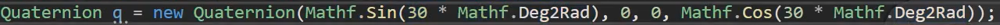
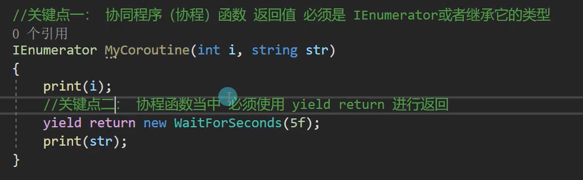
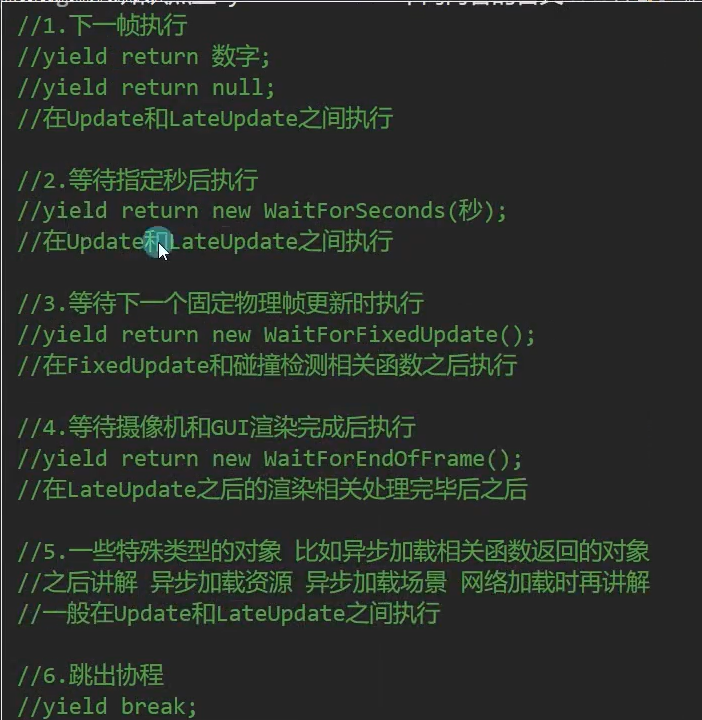
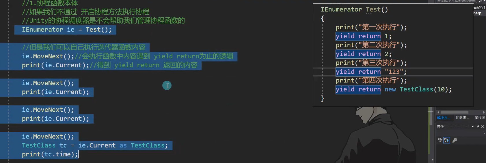
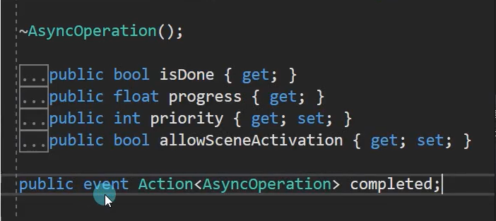
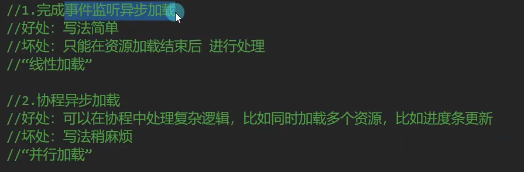
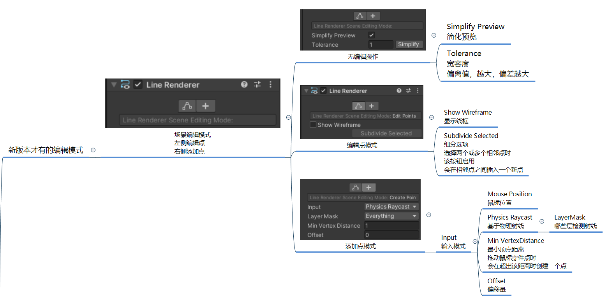
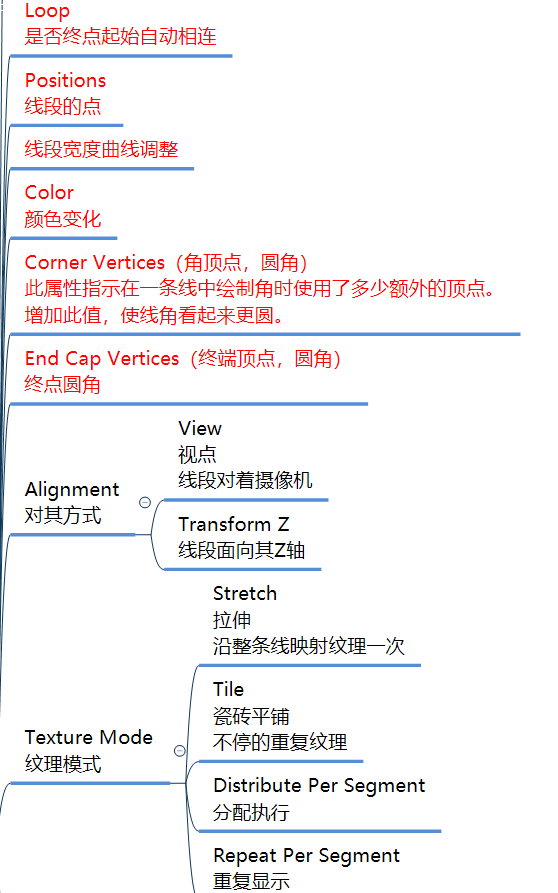
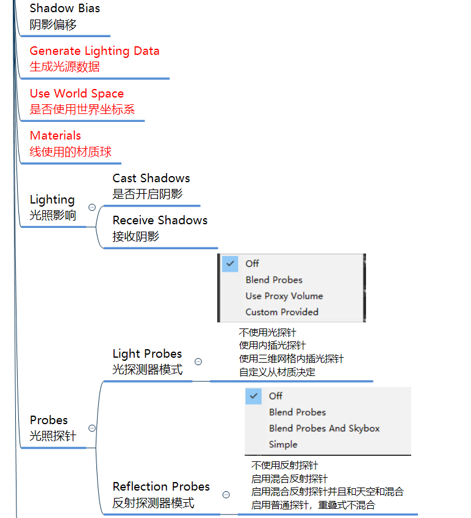
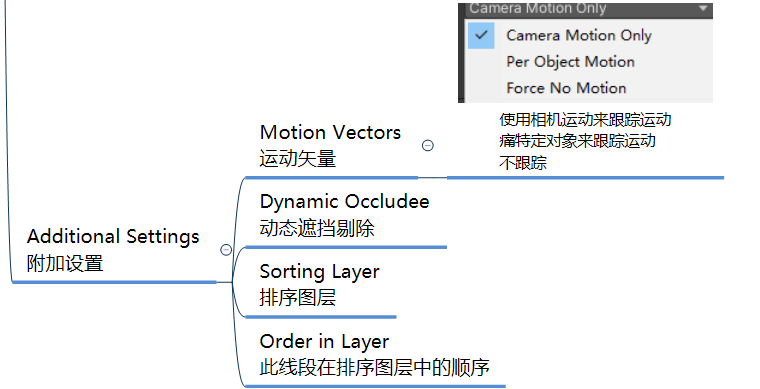

# unity基础

## 基础

### 3d数学

- MathF
  - mathf和math
    - math是C#system命名空间的静态类
    - mathf是unity的结构体，在unityEngine中
  - 区别
    - 方法几乎一样 mathf比math更全面专门用于游戏开发
  - mathf计算一次的方法
    - Mathf.PI = 3.1415926
    - Mathf.Abs( -10 ); 取绝对值
    - Mathf.CeilToInt(float)；向上取整
    - Mathf.FloorToInt(float)；向下取整
    - Mathf.Clamp(value,min,max); 如果value超出min和max范围，会返回min，max
    - Mathf.Max(1,2,3,4,5,6); 变长函数，返回最大那个
    - Mathf.Min(1,2,3,4,5,6); 变长函数，返回最小那个
    - Mathf.Pow(value , n); 一个数n次幂
    - Mathf.RoundToInt(1.4f); 四舍五入
    - Mathf.Sqrt(4); 开根号 返回float
    - Mathf.IsPowerOfTwo(value) 判断一个数是否是2的n次方,返回bool<br>等价 (a - 1) &amp; a == 0
    - Mathf.Sign(value) 判断正负，正的返回1，负的为-1
  - 不停计算
    - 插值Lerp
      ```csharp
      result = Mathf.Lerp(start,end,t);
      t∈[0,1];
      result = start + (end - start)*t
      ```

      - 用法
        ```csharp
        start = Mathf.Lerp(start, 10, Time.deltaTime);
        每帧改变start，无限接近end，先快后满，但不会等于end
        ```

        ```csharp
        time += Time.deltatime;
        result = Mathf.Lerp(start,10,time);
        每帧改变time，匀速前行
        ```

- 三角
  - 弧度和角度替换
    - 1rad = 57.3°<br>1° =0.01745rad
    - 转化<br>Mathf.Rad2Deg = 57.29578<br>Mathf.Deg2Rad = 0.01745f
  - 三角函数，要传入弧度值
    ```csharp
    Mathf.Sin(30 * Mathf.Deg2Rad);
     = sin30°
    ```

  - 反三角，用值推出弧度
    - float rad = Mathf.Asin(0.5f);
- 坐标系
  - 世界坐标系
    - x,y,z<br>z朝向正前方<br>y朝向正上方<br>x朝向正右方
    ```csharp
    相对世界坐标系
    this.transform.position;
    this.transform.rotation;
    this.transform.eulerAngles;
    this.transform.lossyScale;
    ```

  - 物理坐标系
    ```csharp
    相对父对象坐标系
    this.transform.localPosition;
    this.transform.localRotation;
    this.transform.localEulerAngles;
    this.transform.localScale;
    ```

  - 屏幕坐标系
    - 屏幕左下角为原点，x为宽，y为高
    - Input.mousePosition<br>Screen.Height<br>Screen.Weight
  - 视口坐标系
    - 屏幕坐标的百分比 ， 屏幕左下角为原点 ， 屏幕右上角为(1,1)
    - 摄像机上视口范围
  - 转换
    ```csharp
    //世界转本地
     //this.transform.InverseTransformDirection
     //this.transform.InverseTransformPoint
     //this.transform.InverseTransformVector

     //本地转世界
     //this.transform.TransformDirection
     //this.transform.TransformPoint  
     //this.transform.TransformVector

     //世界转屏幕
     //Camera.main.WorldToScreenPoint
     //屏幕转世界
     //Camera.main.ScreenToWorldPoint

     //世界转视口
     //Camera.main.WorldToViewportPoint
     //视口转世界
     //Camera.main.ViewportToWorldPoint

     //视口转屏幕
     //Camera.main.ViewportToScreenPoint

     //屏幕转视口
     //Camera.main.ScreenToViewportPoint;
    ```

- Vector3向量
  - 两点决定向量
    - 终点减起点
    - 向量AB = B - A
  - 零向量，负向量
    - 零向量 Vector3.forward
    - 负向量 -A
  - 向量模长
    - 根号(x方 + y方 + z方)
    - Vector3中的成员magnitude就是模长
  - 单位向量
    - 向量除模长
    - Vector3中的成员normalized就是单位向量
  - 补充
    - 摄像机相关移动放LateUpdate（物体先走，摄像机后动）
- 向量点乘
  - A·B = B在A的投影长度 \* A的长度 || A在B的投影长度 \* B的长度
  - 补充
    ```csharp
    调试画线
    Debug.DrawLine(起点,终点,颜色)
    例子 ： Debug.DrawLine(this.transform.position,this.transform.position + this.transform.forward ,Color.Red)
    ```

    - 画射线
    ```csharp
    Debug.DrawRay(起点,方向,颜色)
    例子 ： Debug.DrawLine(this.transform.position ,this.transform.forward ,Color.Red)
    ```

  - Vector3.Dot(Vector3（乘）,Vector3（被乘）)<br>返回float
  - 夹角计算
    - β = Acos(单位向量x · 单位向量y);
    ```csharp
    计算公式
    Vector3 dir = target.position - this.transform.position; // 目标物体位置减去当前物体位置得到方向向量
    float angle = Mathf.Acos(Vector3.Dot(this.transform.forward, dir.normalized)) * Mathf.Rad2Deg;
    ```

    - api<br>Vector3.Angle(this.transform.forward, dir)；
- 向量叉乘
  - 值为矩阵 	| x    y    z |<br>| a1 b1 c1|<br>| a2 b2 c2|
  - Unity api
    - Vector3.Cross(Vector3(向量1) Vector3,(向量2))<br>返回Vector3
  - 运用
    - a b向量在xz平面，如果a叉乘b的y值大于0，说明b在a左侧，否则在右侧（右手螺旋定理）
- 向量插值
  - Vector3.Lerp(start,end,t)<br>同Mathf中插值，对xyz三点一起插值<br>知识点同Mathf
  - 公式：result = start+ (end - start) \* t（t &lt;= 1）
  - 球形插值
    - Vector3.Slerp(start,end,t)<br>以弧形方向移动
- 4元数
  - 导入
    - Unity自带欧拉角关系是y-&gt;x-&gt;z
    - 令x转90度，y圈和z圈重合，两者旋转结果都是y轴转 ：这种现象是万向节死锁
  - 是什么
    - 一个标量和Vector3向量\[w,(x,y,z)\]<br>意思是绕着n轴旋转多少度
    - 绕着n(x,y,z)旋转β度
      - 四元数Q = \[cos(β/2),sin(β/2)x,sin(β/2)y,sin(β/2)z\]
  - Unit中四元数Quaternino结构体
    - 初始化
      - Quaternino q = new Quaternino(sin(β/2)x,sin(β/2)y,sin(β/2)z,cos(β/2));
        

        - 上图为绕着1，0，0转30度
        - transform中rotation直接是四元数，可以赋值
      - 轴角对初始化
        - Quaternino q = Quaternino.AngleAxis(float(角度),Vector3(轴));
        - Vector3会转换成自身的Vector3，不是世界的
    - 欧拉角四元数转换
      - Quaternion.Euler(x,y,z); 欧拉角转四元数
      - q.eulerAngles; 四元数转欧拉角（Vector3）
    - 四元数相乘代表旋转四元数
  - 常用方法
    - 单位四元数
      - 没有旋转的四元数<br>\[1,(0,0,0)\]：β为0
      - 直接赋值单位四元数给Transform，会把旋转角变成0，0，0
      - Unity表示
        - Quaternion.identity
    - 插值
      - Lerp和Slerp，线性转换和球形转换
      - Slerp效果会好一点，Lerp面对转动过大会比较差
    - 把向量转化为四元数
      - Quaternino.LookRotation(面朝向)<br>把面朝向变成四元数
  - 计算
    - 乘一个四元数相当于旋转
    - 初始化四元数用GetAsix =&gt; 相对于自己当前坐标系旋转
    - 四元数乘向量得到被旋转的向量
      - 只能四元数乘向量，不能反着乘

### Mono中主要内容

- 必须继承Mono
- 延迟函数
  - 指定函数延迟一会执行，时间和函数都能指定（延迟函数执行会阻碍update属于内容，不能塞耗时的函数）
  - Invoke(参数1,参数2)<br>参数1是字符串：需要延迟的函数<br>参数2是时间，以秒为单位，表示需要延迟多久
  - 延迟函数没办法传参数，只能再用一个函数包裹一层
  - 函数名只能是同脚本的函数
  - 延迟重复执行
    - InvokeRepeating(参数1,参数2,参数3)<br>参数1是字符串：需要延迟的函数<br>参数2是第一次执行的等待时间，以秒为单位，表示需要延迟多久<br>参数3是之后执行的等待时间，以秒为单位
  - 取消延迟函数
    - 取消所有延迟函数
      - Cancelnvoke( );
    - 取消指定名字延迟函数
      ```csharp
      CancelInvoke(参数1);
      参数1为函数名字，取消所有同名函数
      ```

  - 判断有无延迟函数
    - IsInvoking() 判断延迟函数是否运行<br>IsInvoking(参数1) 判断指定延迟函数是否运行
  - 延迟函数生命周期
    - 失活对象或脚本，延迟函数没影响<br>对象或脚本销毁或移除，延迟函数也销毁
- 多线程
  - Unity支持多线程，，新开的线程无法访问Unity相关对象内容
    - 多线程一定一定要自己关闭
    - 如果想在结束测试时关闭<br>可以用生命周期函数OnDestory
    ```csharp
    private void OnDestory( )
    {
    	t.Abort( );
    	t = null;
    }
    ```

  - 多线程通常只能用于处理算法逻辑，网络逻辑，主线程通过公共资源来访问
- 协同程序
  - 假的多线程，本质迭代器
    - 通过分时执行，不卡主线程
    - 主要用于异步加载文件，异步下载文件，场景异步加载，批量创建时防止卡顿
  - 关键点
    - 返回值一定要是IEnumerator或其子类
    - 函数中通过yield return 返回值；返回
    - 协程可用IEnumerator或Coroutine类存储
    - 因为会分布执行，可以写死循环而不卡死主线程，不像update写死循环卡死游戏
  

    - 打印整数i<br>等5秒后打印字符串str
  - 协程函数不能直接调用
    ```csharp
    StartCoroutine(参数1);
    参数1：函数或IEnumerator类
    或：字符串（效率低）
    ```

  - 关闭协程
    - StopAllCoroutines( ); //关闭所有协程
    - StopCoroutine(参数1)//关闭指定协程<br>参数1可以是字符串（协程函数名）<br>IEnumerator类<br>Coroutine（协调程序类）最准确
  

    - 协程逻辑<br>4主要是截图时候使用
  - 生命周期
    - 开启协程后<br>物体或组件销毁时：协程结束<br>物体失活：协程结束（这一点和延迟函数不同）<br>组件失活：协程执行
- 协程原理
  - 协程本体是一个能够中间暂停返回的函数
  - 协程调度器是Unity内部实现，会在对应时机执行协程函数
  - 我们可以手动调用迭代器函数
    

    ```c
    每次MoveNext( ),将函数执行到yield return //MoveNext返回bool，表示后面还有没有内容（true表示有）
    每次Current->得到yield return内容（object），如果是类可以被as成原来的形式
    ```

### Resources资源动态加载

- 特殊文件夹
  - 工程路径获取
    - Application.dataPath<br>返回字符串
    - 工程情况下，游戏发布后不存在
  - Resources 资源文件夹
    - 一般不获取，通过Resources相关api加载
    - 需要自己创建
    - 作用
      - 需要通过Resources相关api动态加载资源需放进去<br>该文件下所有资源会打包出去<br>Unity会进行压缩加密<br>打包后只读，只能通过Resources相关API加载
  - StreamingAssets 流动资源文件夹
    - 需要自己创建
    - 获取Application.streamingAssestsPath
    - 流文件夹<br>打包出去不会被压缩加密，随便操作<br>移动平台只读，PC可读可写<br>放一些需要自定义动态加载的初始资源
  - persistentDataPath 持久数据文件夹
    - Application.persistentDataPath获取
    - 无需创建<br>作用<br>固定数据文件夹<br>所有平台可读可写<br>一般放置动态加载或动态创建的文件 游戏中创建或获取的文件都放其中
  - Plugins 插件文件夹
    - 自己创建<br>安装安卓IOS工具<br>SDK接入
  - Editor 编辑器文件夹
    - 自己创建<br>放开发的编辑器相关脚本<br>不会被打包出去
  - Standard Assets
    - Unity下载的默认资源
- 动态加载资源
  - 作用
    - 通过代码动态加载Resources下指定内容<br>减少拖曳操作
  - 常用类型
    - GameObject——预设体（要实例化）<br>AudioChip——音效文件<br>TextAsset——文本文件<br>Texture——图片文件
  - 对象加载
    - 下文所说的路径均为Resources文件夹下子路径
    - 预设体加载
      ```csharp
      1.加载配置到内存
      Object obj = Resources.Load("路径/预设体名字")；
      返回Object类型
      2.实例化
      Instantiate(obj);
      ```

    - 音效加载
      ```csharp
      1.加载配置到内存
      Object obj = Resources.Load("路径/预设体名字")；
      2.赋值给AudioSources脚本(提前准备含audioSources的gameObject)
      as.clip = obj as AudioClip;
      ```

    - 文本资源
      - 支持 .txt .xml .bytes .json
      - TestAsset ta = Resources.Load("路径/名字") as TestAsset
      - 文本内容 ta.text<br>字节数据组 ta.bytes
    - 图片资源
      ```csharp
      Texture tex;
      tex = Resources.Load("路径/名字") as Texture
      后面UI中使用这个tex
      ```

    - 同名资源类型不同
      - tex = Resources("路径/名字"，typeof(Texture)) as Texture
      - 使用LoadAll(名字)加载指定名字的所有资源
  - 泛型方法
    ```csharp
    上面的方法还要as太麻烦
    可以用泛型 TextAssets ta = Resources.Load<TextAsset>("路径/名字");
    ```

- Resources异步加载
  - 内部新开线程进行资源加载，避免卡顿
  - 异步加载不能马上使用，至少等1帧
  - 1.通过异步加载完成事件监听 使用加载的资源
    ```csharp
    ResourceRequest rq = Resources.LoadAsync<GameObject>("路径/名字");
     返回值是unity写好的类
    rq.completed += 函数

    void 函数 (AsyncOperation ao)
    {
    	obj = (ao as ResourceRequest).asset as GameObject;
    	//得到返回的资源 (ao as ResourceRequest).asset，默认object类
    	加载完后的逻辑
    }
    函数是当加载完成后执行的函数
    ```

    - ResourceRequest类
      

      - isDone表示资源是否加载完成<br>progress表示进度0~1，1表示完成<br>priority表示自己优先级，越小越高
  - 2.通过协程 使用加载的资源
    ```csharp
    IEnumerator Load()
    {
    	ResourceRequest rq = Resources.LoadAsync<GameObject>("路径/名字");
    	yield return rq; //unity自己实现的协程调度可以判断ResourceRequest是否加载完成，加载完成才进行下一步
    	obj = rq.asset as GameObject;
    }
    ```

    ```csharp
    IEnumerator Load()
    {
    	ResourceRequest rq = Resources.LoadAsync<GameObject>("路径/名字");
    	while(!isDone)
    	{
    		yield return null;
    	}
    	obj = rq.asset as GameObject;
    }
    ```

  

- 资源卸载
  - Resources加载后回放内存作为缓存，能够取出来直接用，多次加载不浪费内存
  - 卸载指定资源
    - Resources.UnloadAsset(tex) //资源变量<br>释放了记得置空，避免占用引用<br>一定不能卸载GameObject类资源！
    - Ctrl + 7打开调试窗口查看CPU内存
  - 卸载未使用资源（常用）
    - 内存有瓶颈，过场景，GC时使用
    ```csharp
    Resources.UnloadUnusedAssets( );
    //顺便GC
    GC.Collect( );
    ```

### 场景异步加载

- SenceManager.LoadSenceAsnyc("场景名字")<br>//加载完成自动换场景<br>返回值是AsnycOperation=&gt;有isDone，progress，事件completed
  - 场景加载结束后，可以执行completed的内容
- 通过协程加载
  - 注意，加载场景会把当前场景没有特殊处理对象删除<br>协程中的部分逻辑可能执行不了<br>需要让 处理场景加载的脚本 依附的对象 过场景时 不被删除
  - 使用DontDestoryOnLoad(this.gameOject):<br>保存当前依附的gameObject对象不在过场景是删除<br>保护协程不被删
  - 使用协程可以在场景加载是更新进度条

### 画线功能LineRenderer

- 绘制攻击范围，<br>辅助线<br>武器攻击线






  - 是否使用世界坐标（不勾选则线段跟着gameObject动）
  - 使用光的数据（受光影响的材质需要打开才能看到）


- 代码绘制
  - 创键LineRender对象
    ```csharp
    GameObject line = new GameObject( );
    line.name = Line;//创对象，设名字
    LineRenderer lineRender = line.AddCompoment<LineRenderer>( );//上LineRender脚本
    ```

  - 绘制
    ```csharp
    lineRender.loop = true//设置loop
    lineRender.startWidth = 0.02f;
    lineRender.endWidth = 0.02f; // 设置开始结束宽
    lineRender.startColor = Color.Red;
    lineRender.endColor = Color.Green;//渐变颜色
    lineRender.material = m//可通过Reasource加载出Material类对象
    lineRender.useWorldSpace = true;//是否跟随世界坐标移动
    lineRender.generateLightingData = true//是否使用光照
    ```

  - 加点
    ```csharp
    lineRender.positonCount = 4;//设置点数
    lineRender.setPositions(new Vector3[] {new Vector3(0,0,0),new Vector3(0,5,5)})
    //数量不够用0，0，0点填充
    lineRenser.setPosition(2,new Vector3(2,2,2)) //指定索引2的点设为2，2，2
    ```

## 物理系统

### 范围检测

- 对于没有实体物体，如火球术，挥砍这种只想检测有无伤害时便可使用范围检测<br>在指定位置进行判断，我们可以得到指定范围内的对象，可以对他们进行通知执行操作
- 必备条件
  - 想要被范围检测到的对象必须有碰撞器
- 知识点
  - 1范围检测相关api在调用时，只会瞬时检测一次
  - 2范围检测api调用时，不会产生碰撞器，只会进行碰撞计算
- 范围检测api
  - 盒状范围检测
    - Physics.OverlapBox(参数1，参数2，参数3，参数4，参数5)<br>参数1：立法体中心点(世界坐标)<br>参数2：立方体三边大小（Vector3 长宽高的一半）如果是vector3.one ,打印一个2\*2\*2大小的方形<br>参数3：立方体角度（四元数）this.transform.rotation表示与物体角度一至<br>参数4：检测自定层级（不填选择所有层，传入int，规范<br>（1&lt;&lt;LayerMask.NameToLayer("层级名")）|（1&lt;&lt;LayerMask.NameToLayer("层级名")）|（1&lt;&lt;LayerMask.NameToLayer("层级名")））<br>参数5：是否忽略触发器	useGlobal-全局设置 Collide-检测触发器 Ignore-不检测，不填使用useGlobal(QueryTriggerInteration枚举)
      - 全局检测位置在Edit-&gt;ProjectSetting-&gt;Physics-&gt;Queries Hits Triggers
    - 返回一个Colider数组表示范围内被检测的所有碰撞器
    - Physics.OverlapBoxNonAlloc(参数。。。)<br>与上一个相似，返回值是检测到碰撞器的数量，可以传入一个参数来存储检测到的Colider<br>可以配合if
  - 球形范围检测
    - Physics.OverlapSphere(世界坐标，半径，层级，是否有触发器)
    - Physics.OverlapBoxNonAlloc(参数。。。)
  - 胶囊
    - Physics.OverlapCapsule(上半圆中心世界坐标，下半圆中心世界坐标，半圆半径，层级，是否有触发器)

### Layer/Tag重点知识

- layer层数从0-31一共32层
- 编号依次为1(1 &lt;&lt; 0)，2(1 &lt;&lt; 1)，4(1 &lt;&lt; 2)，8(1 &lt;&lt; 3)，16(1 &lt;&lt; 4)为2的幂次刚好用int表示32个数
- 这样做的好处是用一个int就可以表示所有要表示的层级的组合<br>如7就可以表示第0+1+2三层组合<br>如果要反选的话可以拿-1（32个1对应的数）去异或那些需要不选的层级

### 射线检测

- 判断一条线与物体碰撞的情况
- 射线定义
  ```csharp
  Ray r = new Ray(Vector3(起点)，Vector(方向向量));
  Ray r = new Ray(Vector3.right,Vector3.forward) // 从（1，0，0）往z轴正方向射出的射线
  r.origin起点	r.direction方向
  ```

  ```csharp
  Ray r = Camera.main.ScreenPointToRay(Input.mousePosition);
  new一个屏幕上鼠标点位置的射线
  ```

- 射线检测函数
  - 射线检测是瞬时的
  - 原始射线检测
    - Physics.Raycast(参数1,参数2,参数3,参数4)<br>参数1 射线Ray<br>参数2 检测最大距离float<br>参数3 检测指定层级int 用1&lt;&lt; LayerMask.NameToLayer("name")<br>参数4 是否检测触发器 QueryTriggerInteraction<br>返回bool值表示有无碰撞到对象
      - 有一种重载就是把参数1Ray换成两个参数Vector3，表示射线起点和方向
    - 获取相交的单个物体信息<br>物理信息类 RaycastHit ，用之前要定义 不用new
      ```csharp
      Physics.Raycast(参数1,参数2,参数3,参数4,参数5)
      参数1 射线Ray
      参数2 空的结构体 RaycastHit （要带out）
      参数3 检测最大距离float
      参数4 检测指定层级int 用1<< LayerMask.NameToLayer("name")
      参数5 是否检测触发器 QueryTriggerInteraction
      返回bool值表示有无碰撞到对象，RaycastHit表示检测到的对象
      ```

      - RaycastHit结构体有碰撞器信息collider成员<br>可以直接引用<br>RaycastHit还可以得到point（一个Vector3）表示碰撞的点<br>RaycastHit还有normals（一个vector3）表示法线<br>RaycastHit有distance（float）表示是射击点到目标距离
    - 获取多个碰撞对象
      ```csharp
      Physics.RaycastAll(参数1,参数2,参数3,参数4)
      参数1 射线Ray
      参数2 检测最大距离float
      参数3 检测指定层级int 用1<< LayerMask.NameToLayer("name")
      参数4 是否检测触发器 QueryTriggerInteraction
      返回RaycastHit数组表示所有相交的物体
      ```

    - 通过数组得到
      ```csharp
      Physics.RaycastNonAlloc(参数1,参数2,参数3,参数4,参数5)
      参数1 射线Ray
      参数2 通过传入RaycastHit来得到数据
      参数3 检测最大距离float
      参数4 检测指定层级int 用1<< LayerMask.NameToLayer("name")
      参数5 是否检测触发器 QueryTriggerInteraction
      返回RaycastHit数组表示所有相交的物体
      ```

    - 注意
      - 一定是传了距离后才能传层级，不可能不传距离传层级
